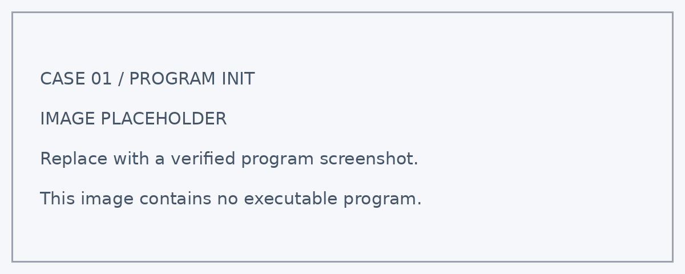
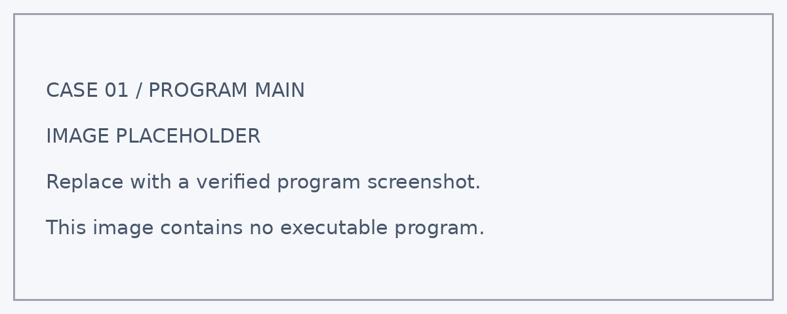

# 案例一：城市光照观察器

## 案例简介

教室里靠窗的位置与走廊为什么亮度不同？在相同时间，不同地点的光照读数是否一样？本案例使用 **Nezha ESP32** 的板载光敏传感器采集环境光照，并在屏幕上显示读数。学生通过定点测量与记录，比较不同区域的光照差异，学习用数据描述身边的环境。

学生将通过搭建、编程和测试，把观测结果与模型的显示或动作联系起来，学习用数据解释现象。

通过本案例，学生可以结合课堂观察与工程实践，思考如何利用技术改善校园和城市环境。

<!-- 图片占位符：城市光照观察器成品图 -->
<!-- 建议文件名：./images/urban-light-observer.png -->

## 教学准备

| 名称 | 数量 | 用途 |
| --- | ---: | --- |
| 城市气候守护套装 | 1 套 | 搭建城市光照观察器模型 |
| Nezha ESP32 | 1 个 | 运行程序、读取数据并显示信息 |
| RJ11 连接线 | 按实际需要 | 连接兼容的外接模块；纯板载功能无需外接 |
| 电脑及数据线 | 1 套 | 编写、下载和调试程序 |

<!-- 图片占位符：教学准备 / 套装与主要模块合照 -->
<!-- 建议文件名：./images/urban-light-observer-materials.png -->

## 教学目标

完成本案例后，学生能够：

1. 读取光照数据，并理解读数随环境明暗变化的规律。
2. 使用变量保存数据，在屏幕上显示带有名称的测量结果。
3. 控制测量条件，比较多个地点的读数并解释差异。
4. 根据测试结果调整参数，经历“设计—编程—测试—改进”的工程实践过程。

## 课程引入

光照会影响我们的阅读、活动和植物生长。请学生观察教室，预测哪个位置最亮、哪个位置最暗，再用传感器验证。提醒学生：感觉与测量可能不同，结论应由重复观测支持。

本节课中，我们将扮演“城市环境设计师”，搭建城市光照观察器，用实际观测检验自己的设计。

## 学习探究

在开始搭建前，可以分组讨论以下问题：

1. 为什么测量时不能用手遮住传感器？
2. 相同地点早晨与下午的读数会不会相同？
3. 一次读数能代表整个地点的光照情况吗？
4. 你会怎样记录测试条件，说明结果是否符合预期？
5. 如果把模型应用到真实环境，还需要考虑哪些因素？

## 搭建步骤

按照搭建说明完成城市光照观察器的底座、主控安装位和相关功能结构。

搭建时重点检查：

- 搭建稳固的观察台，使光敏传感器朝向待测环境。
- 保留传感器周围的空隙，避免积木或线材遮挡。
- 为每次测量确定相同的摆放高度与朝向。

<!-- 图片占位符：积木搭建步骤图，可按步骤 1、步骤 2……依次插入 -->
<!-- 建议文件名：./images/urban-light-observer-build-01.png 等 -->

## 硬件连接

关闭电源后，按照下表连接模块：

| 模块 | 接口 | 作用 |
| --- | --- | --- |
| 板载光敏传感器 | 板载，无需外接 | 环境光照输入 |
| 板载屏幕 | 板载，无需外接 | 显示光照读数 |

:::tip
板载功能无需外接线。外接模块应按最终程序确认兼容接口；使用 IIC 模块时还应核对总线地址。接线时请对准接口方向，不要在设备通电时插拔模块。
:::

<!-- 图片占位符：硬件连接示意图 -->
<!-- 建议文件名：./images/urban-light-observer-wiring.png -->

## 程序设计

程序分为“启动初始化”和“循环运行”两个部分。

:::note
以下为教学逻辑建议稿。当前未提供本案例实际程序，接口编号、积木名称和控制参数须以实机验证结果为准；程序截图位置暂用明确标注的占位图。下方屏幕布局同样为建议方案。
:::

### 1. 启动初始化

<!-- 图片占位符：启动初始化程序截图 -->

程序启动后将执行以下操作：

1. 创建“光照值”变量；显示案例标题与数据标签。
2. 初始化屏幕与数据变量，避免沿用上一次运行的状态。
3. 在屏幕预定位置显示数据标签与初始运行状态。

主控盒屏幕的显示布局如下：

| 屏幕行 | 显示内容 |
| ---: | --- |
| 第 1 行 | 光照读数 |
| 第 2 行 | 相对光照值 |
| 第 3 行 | 运行状态 |
| 第 4 行 | 明亮程度 |

### 2. 循环检测与控制

<!-- 图片占位符：循环检测与控制程序截图 -->

在 `forever` 循环中，系统会持续执行以下任务。

#### 循环采样

- 读取板载光敏传感器，将结果写入“光照值”。

#### 显示与等待

- 在固定位置更新数值，适当等待后再次采样；避免整屏频繁清空。

### 3. 关键参数

| 参数 | 示例值 | 含义 | 调整建议 |
| --- | ---: | --- | --- |
| 采样间隔 | 待实机确认 | 用于观察变化，按实际积木支持调整 | 课堂起点可设为 0.5–1 秒 |
| 测量次数 | 待实机确认 | 保持高度与朝向一致 | 每个地点至少 3 次 |

:::note
光敏传感器将环境明暗变化转换为可读取的数据。程序循环读取数值、保存到变量并更新屏幕，形成连续观察。此处光照读数先作为相对值使用；未经模块文档及校准确认，不标注为 lux，也不用于判断是否达到教室照明标准。
:::

## 运行测试

完成程序后，按以下顺序测试：

1. **启动检查**：连接设备并下载已验证程序，确认初始化状态与屏幕标签正确。
2. **轻轻遮挡后移开**：读数随明暗变化，屏幕持续更新。
3. **依次测量窗边、教室中央和走廊**：记录地点、时间与多次读数，比较差异。
4. **回到第一个地点复测**：检查变化是否与环境条件有关。
5. **复测与记录**：改变一个条件后重复测试，记录输入、输出与结果。

如果出现“读数变化很小”，确认未被积木遮挡，并尝试差异更明显的明暗环境。

如果出现“屏幕闪烁或旧数字残留”，降低刷新频率；使用固定显示区域或清除上一次数值。

## 案例演示

程序运行后，城市光照观察器可以呈现以下效果：

- 读数随明暗变化，屏幕持续更新。
- 记录地点、时间与多次读数，比较差异。
- 检查变化是否与环境条件有关。

<!-- 图片占位符：案例运行效果图或演示动图 -->
<!-- 建议文件名：./images/urban-light-observer-demo.gif -->

## 总结分享

请各小组展示作品，并围绕以下问题进行交流：

1. 你们记录了哪些数据？测试条件是否保持一致？
2. 本案例使用了哪些判断规则或数据处理方法？
3. 测试过程中出现了哪些结构或程序问题？你们是怎样解决的？
4. 哪一项测试最能证明作品实现了预期功能？
5. 如果继续改进，你们最想优化什么？为什么？

## 扩展挑战

### 挑战一：比较不同距离下的读数

保持光源亮度不变，改变光源与传感器的距离。每个距离重复测量，记录读数并比较变化。

### 挑战二：增加明暗等级提示

为光照值设置高、中、低三个等级，在屏幕上显示对应状态。先记录现场数据，再确定分级阈值。

### 挑战三：记录一天中的变化

在同一地点按相同时间间隔记录光照读数。结合天气和遮挡情况，解释一天中的变化。

### 挑战四：比较遮挡材料

用不同材料遮挡同一光源，保持距离与朝向一致。比较材料对光照读数的影响。

### 挑战五：制作校园光照地图

选择校园内多个点位，记录位置、时间与光照读数。把结果标在地图上，并说明测量条件。

## 扩展知识

### 为什么不同地点的读数不同？

光源位置、遮挡物和传感器朝向都会影响读数。比较地点时，应尽量保持测量高度、朝向和时间一致。

### 相对读数与照度有什么区别？

相对读数用于比较当前设备感受到的明暗；照度通常使用 lx 表示。未经校准与单位确认，不应把相对读数直接标成标准照度。

### 为什么需要重复测量？

一次测量可能受到人员走动或临时遮挡影响。重复测量并记录变化范围，可以让比较更有依据。
