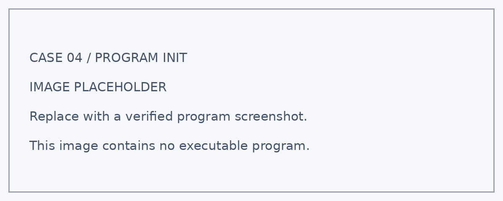
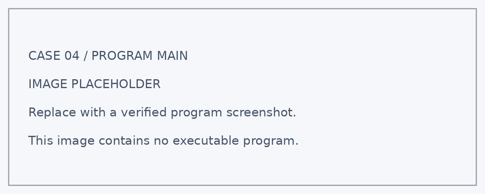

# 案例四：IoT 城市微环境看板

## 案例简介

如果想在另一台设备上查看校园不同位置的环境变化，可以怎样做？本案例将 **Nezha ESP32** 采集的光照、声音和姿态相关数据，通过无线网络上传到 SmartIoT 平台。学生在本地显示与远程曲线之间建立联系，理解数据采集、传输和展示的完整过程。

学生将通过搭建、编程和测试，把观测结果与模型的显示或动作联系起来，学习用数据解释现象。

通过本案例，学生可以结合课堂观察与工程实践，思考如何利用技术改善校园和城市环境。

<!-- 图片占位符：IoT 城市微环境看板成品图 -->
<!-- 建议文件名：./images/iot-urban-microenvironment-dashboard.png -->

## 教学准备

| 名称 | 数量 | 用途 |
| --- | ---: | --- |
| 城市气候守护套装 | 1 套 | 搭建IoT 城市微环境看板模型 |
| Nezha ESP32 | 1 个 | 运行程序、读取数据并显示信息 |
| SmartIoT 账号及对应项目/设备配置 | 按实际配置 | 完成本案例对应的检测、控制或联网任务 |
| RJ11 连接线 | 按实际需要 | 连接兼容的外接模块；纯板载功能无需外接 |
| 电脑及数据线 | 1 套 | 编写、下载和调试程序 |

<!-- 图片占位符：教学准备 / 套装与主要模块合照 -->
<!-- 建议文件名：./images/iot-urban-microenvironment-dashboard-materials.png -->

## 教学目标

完成本案例后，学生能够：

1. 区分传感器、本地主控、无线网络与平台的作用。
2. 为不同数据配置明确的字段名称和单位说明。
3. 观察时间序列，识别缺测、异常值和环境变化。
4. 根据测试结果调整参数，经历“设计—编程—测试—改进”的工程实践过程。

## 课程引入

提出任务：教室里的观察器放在窗边，教师能否在电脑上查看它的变化？请学生画出从传感器到看板的数据路径，并预测网络断开时会发生什么。

本节课中，我们将扮演“城市环境设计师”，搭建IoT 城市微环境看板，用实际观测检验自己的设计。

## 学习探究

在开始搭建前，可以分组讨论以下问题：

1. 平台上的数据与屏幕上的读数如何对应？
2. 网络断开是否意味着传感器停止工作？
3. 上传太快会带来哪些问题？
4. 你会怎样记录测试条件，说明结果是否符合预期？
5. 如果把模型应用到真实环境，还需要考虑哪些因素？

## 搭建步骤

按照搭建说明完成IoT 城市微环境看板的底座、主控安装位和相关功能结构。

搭建时重点检查：

- 搭建便于观察的固定底座，保持传感器无遮挡。
- 选择网络覆盖良好且便于教师管理的位置。
- 标记设备名称和采样地点，避免混淆不同小组的数据。

<!-- 图片占位符：积木搭建步骤图，可按步骤 1、步骤 2……依次插入 -->
<!-- 建议文件名：./images/iot-urban-microenvironment-dashboard-build-01.png 等 -->

## 硬件连接

关闭电源后，按照下表连接模块：

| 模块 | 接口 | 作用 |
| --- | --- | --- |
| 板载光敏、麦克风与姿态传感器 | 板载；字段支持待确认 | 环境与姿态采集 |
| Wi-Fi | 网络配置由教师提供 | 与平台通信 |
| SmartIoT 数据字段 | 字段映射、认证方式待实际项目确认 | 存储并展示上传值 |

:::tip
板载功能无需外接线。外接模块应按最终程序确认兼容接口；使用 IIC 模块时还应核对总线地址。接线时请对准接口方向，不要在设备通电时插拔模块。
:::

<!-- 图片占位符：硬件连接示意图 -->
<!-- 建议文件名：./images/iot-urban-microenvironment-dashboard-wiring.png -->

## 程序设计

程序分为“启动初始化”和“循环运行”两个部分。

:::note
以下为教学逻辑建议稿。当前未提供本案例实际程序，接口编号、积木名称和控制参数须以实机验证结果为准；程序截图位置暂用明确标注的占位图。下方屏幕布局同样为建议方案。
:::

### 1. 启动初始化

<!-- 图片占位符：启动初始化程序截图 -->

程序启动后将执行以下操作：

1. 在平台建立项目或设备，按实际教程配置字段与看板。
2. 初始化屏幕与数据变量，避免沿用上一次运行的状态。
3. 在屏幕预定位置显示数据标签与初始运行状态。

主控盒屏幕的显示布局如下：

| 屏幕行 | 显示内容 |
| ---: | --- |
| 第 1 行 | 环境数据 |
| 第 2 行 | 光照、声音与姿态等采样值 |
| 第 3 行 | 运行状态 |
| 第 4 行 | 在线 / 离线 |

### 2. 循环检测与控制

<!-- 图片占位符：循环检测与控制程序截图 -->

在 `forever` 循环中，系统会持续执行以下任务。

#### 平台准备

- 在平台建立项目或设备，按实际教程配置字段与看板。

#### 连接网络

- 在程序中配置连接参数，显示连接状态；不在公开截图中展示密码或密钥。

#### 采集与上传

- 依次采集数据，本地显示；达到上传间隔且网络可用时发送。

#### 异常处理

- 断网时继续本地采集与显示，提示离线；重新连接后恢复上传。

### 3. 关键参数

| 参数 | 示例值 | 含义 | 调整建议 |
| --- | ---: | --- | --- |
| 本地采样间隔 | 待实机确认 | 可与上传间隔不同 | 按观察需要设置 |
| 上传间隔 | 待实机确认 | 课堂可从较低频率开始 | 以平台频率限制为准 |
| 字段与单位 | 待实机确认 | 相对读数不标作 lux 或 dB | 与平台一一对应 |

:::note
主控定期采集数据，将其映射到平台配置的字段后发送。平台按接收时间展示记录。光照和声音使用相对读数；姿态字段需写明所选轴与输出含义。账号创建、连接方式、认证参数和发送频率限制，以实际 SmartIoT 教程及当前扩展库为准。
:::

## 运行测试

完成程序后，按以下顺序测试：

1. **启动检查**：连接设备并下载已验证程序，确认初始化状态与屏幕标签正确。
2. **连接成功后改变光照**：本地数值变化，平台随后出现对应记录。
3. **比对三个字段**：名称、数据类型和含义匹配，无错位。
4. **临时断网再恢复**：本地仍可显示，离线有提示，恢复后可继续上传。
5. **复测与记录**：改变一个条件后重复测试，记录输入、输出与结果。

如果出现“本地有值但平台无记录”，检查网络、认证配置、设备或项目选择及发送间隔。

如果出现“曲线异常或字段混淆”，逐项上传已知数据检查映射，并核对时间和数据类型。

## 案例演示

程序运行后，IoT 城市微环境看板可以呈现以下效果：

- 本地数值变化，平台随后出现对应记录。
- 名称、数据类型和含义匹配，无错位。
- 本地仍可显示，离线有提示，恢复后可继续上传。

<!-- 图片占位符：案例运行效果图或演示动图 -->
<!-- 建议文件名：./images/iot-urban-microenvironment-dashboard-demo.gif -->

## 总结分享

请各小组展示作品，并围绕以下问题进行交流：

1. 你们记录了哪些数据？测试条件是否保持一致？
2. 本案例使用了哪些判断规则或数据处理方法？
3. 测试过程中出现了哪些结构或程序问题？你们是怎样解决的？
4. 哪一项测试最能证明作品实现了预期功能？
5. 如果继续改进，你们最想优化什么？为什么？

## 扩展挑战

### 挑战一：增加地点编号

为每条上传记录增加地点编号。更换地点时更新编号，确认平台能够区分各组数据。

### 挑战二：记录离线状态

在屏幕显示联网状态，并记录上传失败事件。临时断网后检查本地采样是否仍能运行。

### 挑战三：比较不同上传周期

使用不同上传周期进行相同时间长度的实验。比较数据数量、曲线细节和平台限制。

### 挑战四：增加趋势说明

观察一段时间的数据，用文字说明上升、下降或波动。将观察结论与真实环境变化对应。

### 挑战五：设计多人共享看板

为不同小组设置可区分的设备或数据字段。共享看板中只展示课堂数据，避免公开网络凭据。

## 扩展知识

### 什么是物联网？

物联网让设备通过网络交换数据。本案例由传感器采样、Nezha ESP32 处理数据，再通过平台展示，实现从本地观察到远程查看。

### 上传周期与采样周期相同吗？

设备可以较频繁地采样，而以较低频率上传。两个周期应分别设置，并遵守平台限制，避免无意义的重复发送。

### 为什么需要时间与数据状态？

同一个数值在不同时间可能有不同含义。记录时间以及有效、缺测或离线状态，有助于正确解释曲线，避免把缺测当成零。
