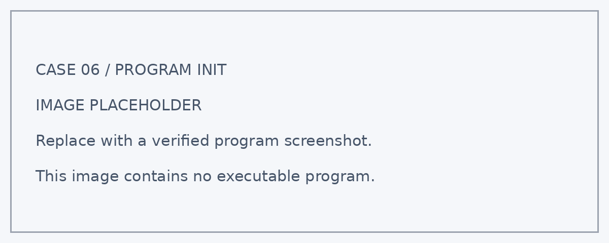
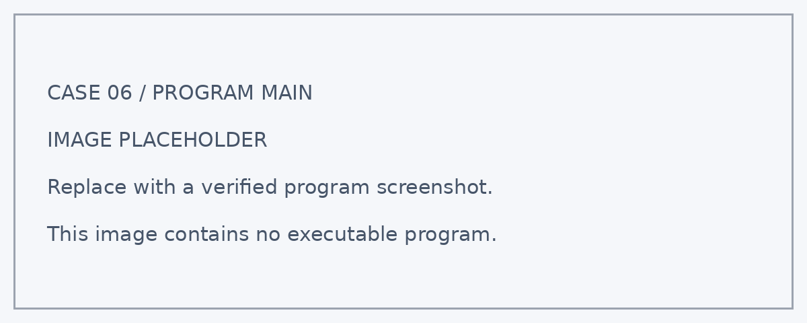

# 案例六：智能遮阳站

## 案例简介

公共休息区域的遮阳棚能否随着光照变化自动展开？本案例通过 **Nezha ESP32** 的板载光敏传感器感知环境明暗，控制电机带动遮阳结构展开或收回。学生将传感器判断与机械动作结合，探索自动遮阳模型的设计方法。

学生将通过搭建、编程和测试，把观测结果与模型的显示或动作联系起来，学习用数据解释现象。

通过本案例，学生可以结合课堂观察与工程实践，思考如何利用技术改善校园和城市环境。

<!-- 图片占位符：智能遮阳站成品图 -->
<!-- 建议文件名：./images/smart-shading-station.png -->

## 教学准备

| 名称 | 数量 | 用途 |
| --- | ---: | --- |
| 城市气候守护套装 | 1 套 | 搭建智能遮阳站模型 |
| Nezha ESP32 | 1 个 | 运行程序、读取数据并显示信息 |
| 配套电机及遮阳传动结构 | 按实际配置 | 完成本案例对应的检测、控制或联网任务 |
| RJ11 连接线 | 按实际需要 | 连接兼容的外接模块；纯板载功能无需外接 |
| 电脑及数据线 | 1 套 | 编写、下载和调试程序 |

<!-- 图片占位符：教学准备 / 套装与主要模块合照 -->
<!-- 建议文件名：./images/smart-shading-station-materials.png -->

## 教学目标

完成本案例后，学生能够：

1. 根据光照相对读数设置展开与收回条件。
2. 识别电机类型及其对应的控制方法。
3. 调试机械行程，保证遮阳结构在安全范围内运动。
4. 根据测试结果调整参数，经历“设计—编程—测试—改进”的工程实践过程。

## 课程引入

请学生观察候车站或窗边遮阳设施，讨论固定遮阳与可调遮阳各适合什么情境。提出任务：设计一座能根据光照变化调整遮阳棚的模型。

本节课中，我们将扮演“城市环境设计师”，搭建智能遮阳站，用实际观测检验自己的设计。

## 学习探究

在开始搭建前，可以分组讨论以下问题：

1. 棚展开后会不会遮住光敏传感器？
2. 普通直流电机能否直接用角度积木控制？
3. 为什么要先手动检查机械行程再通电？
4. 你会怎样记录测试条件，说明结果是否符合预期？
5. 如果把模型应用到真实环境，还需要考虑哪些因素？

## 搭建步骤

按照搭建说明完成智能遮阳站的底座、主控安装位和相关功能结构。

搭建时重点检查：

- 搭建稳固的棚架，使棚体活动时不碰到主控或线材。
- 断电手动检查行程，标记展开端与收回端。
- 将光敏传感器放在不被自身遮阳棚遮挡的位置。

<!-- 图片占位符：积木搭建步骤图，可按步骤 1、步骤 2……依次插入 -->
<!-- 建议文件名：./images/smart-shading-station-build-01.png 等 -->

## 硬件连接

关闭电源后，按照下表连接模块：

| 模块 | 接口 | 作用 |
| --- | --- | --- |
| 板载光敏传感器 | 板载，无需外接 | 检测环境明暗 |
| 遮阳电机 | 兼容电机接口待确认；角度/限位方式待确认 | 驱动棚体展开与收回 |

:::tip
板载功能无需外接线。外接模块应按最终程序确认兼容接口；使用 IIC 模块时还应核对总线地址。接线时请对准接口方向，不要在设备通电时插拔模块。
:::

<!-- 图片占位符：硬件连接示意图 -->
<!-- 建议文件名：./images/smart-shading-station-wiring.png -->

## 程序设计

程序分为“启动初始化”和“循环运行”两个部分。

:::note
以下为教学逻辑建议稿。当前未提供本案例实际程序，接口编号、积木名称和控制参数须以实机验证结果为准；程序截图位置暂用明确标注的占位图。下方屏幕布局同样为建议方案。
:::

### 1. 启动初始化

<!-- 图片占位符：启动初始化程序截图 -->

程序启动后将执行以下操作：

1. 按实际电机方案确定安全起点和终点，初始化目标状态。
2. 初始化屏幕与数据变量，避免沿用上一次运行的状态。
3. 在屏幕预定位置显示数据标签与初始运行状态。

主控盒屏幕的显示布局如下：

| 屏幕行 | 显示内容 |
| ---: | --- |
| 第 1 行 | 光照值 |
| 第 2 行 | 光照相对值 |
| 第 3 行 | 运行状态 |
| 第 4 行 | 遮阳棚展开 / 收回 |

### 2. 循环检测与控制

<!-- 图片占位符：循环检测与控制程序截图 -->

在 `forever` 循环中，系统会持续执行以下任务。

#### 结构校准

- 按实际电机方案确定安全起点和终点，初始化目标状态。

#### 光照判断

- 读取光照；超过阈值时目标为展开，否则为收回。

#### 动作控制

- 只有目标与当前状态不同才执行动作，到位后停止并更新状态。

### 3. 关键参数

| 参数 | 示例值 | 含义 | 调整建议 |
| --- | ---: | --- | --- |
| 光照阈值 | 待实机确认 | 相对值，不直接标作照度单位 | 根据课堂明暗环境测量确定 |
| 展开/收回终点 | 待实机确认 | 未获得实际程序前不指定固定角度 | 以实物结构校准为准 |
| 动作速度 | 待实机确认 | 避免堵转与夹手 | 从低速调试 |

:::note
程序将光照读数与阈值比较，并把判断结果转为目标状态。电机只在目标状态改变时执行动作，避免循环中反复驱动。具体使用角度、编码器、限位或定时控制，须由实际电机与结构确定，不能把不同电机的控制方法混用。
:::

:::caution
先低速校准机械零位与行程，确认遮阳棚不会撞限位或挤压线材，再运行自动控制。
:::

## 运行测试

完成程序后，按以下顺序测试：

1. **启动检查**：连接设备并下载已验证程序，确认初始化状态与屏幕标签正确。
2. **改变环境明暗**：棚体按设定规则展开或收回。
3. **保持环境不变**：电机不反复顶住终点或持续运转。
4. **多次切换**：运动平顺，传感器不因棚体遮挡造成来回动作。
5. **复测与记录**：改变一个条件后重复测试，记录输入、输出与结果；结束时停止执行器。

如果出现“电机方向相反”，检查安装方向，调整控制方向或目标位置。

如果出现“在阈值附近反复开合”，检查自身遮挡，并增加回差或连续判断。

## 案例演示

程序运行后，智能遮阳站可以呈现以下效果：

- 棚体按设定规则展开或收回。
- 电机不反复顶住终点或持续运转。
- 运动平顺，传感器不因棚体遮挡造成来回动作。

<!-- 图片占位符：案例运行效果图或演示动图 -->
<!-- 建议文件名：./images/smart-shading-station-demo.gif -->

## 总结分享

请各小组展示作品，并围绕以下问题进行交流：

1. 你们记录了哪些数据？测试条件是否保持一致？
2. 本案例使用了哪些判断规则或数据处理方法？
3. 测试过程中出现了哪些结构或程序问题？你们是怎样解决的？
4. 哪一项测试最能证明作品实现了预期功能？
5. 如果继续改进，你们最想优化什么？为什么？

## 扩展挑战

### 挑战一：加入展开与收回双阈值

使用不同的展开与收回光照阈值。观察临界光照附近是否减少反复动作。

### 挑战二：增加手动模式

增加手动展开和收回功能。明确手动模式与自动模式的切换方式，避免同时发出相反指令。

### 挑战三：比较不同棚面

在机构行程不变的前提下比较不同棚面。观察遮挡效果、结构重量及运行稳定性。

### 挑战四：记录动作次数

只在目标状态发生变化时累计动作次数。比较不同阈值方案的动作频率。

### 挑战五：联动温度与光照

加入温度数据，与光照共同决定遮阳状态。先写出条件组合表，再测试每种组合。

## 扩展知识

### 遮阳怎样改善环境？

遮阳结构可以减少阳光直射。在模型中，传感器提供明暗信息，电机带动机构运动，帮助学生理解环境数据如何驱动机械动作。

### 电机角度等于棚面角度吗？

齿轮、连杆和蜗杆等传动结构会改变运动关系。电机转动多少并不能直接等同于棚面展开角度，需要实测机构行程。

### 为什么需要确认机械零位？

程序设定的位置必须与模型的实际起点对应。低速校准收回和展开位置，可以减少撞限位和重复堵转。
