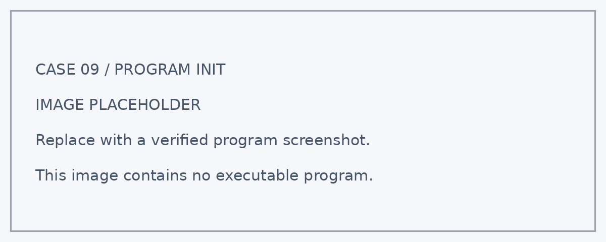
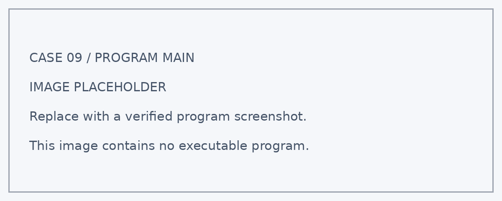

# 案例九：城市天气趋势记录器

## 案例简介

天气变化前后，气压数据会怎样变化？本案例通过气压传感器定时采集数据，并上传到 SmartIoT 平台形成曲线。学生在相同地点持续记录，结合实际天气观察，学习比较时间序列并提出有依据的解释。

学生将通过搭建、编程和测试，把观测结果与模型的显示或动作联系起来，学习用数据解释现象。

通过本案例，学生可以结合课堂观察与工程实践，思考如何利用技术改善校园和城市环境。

<!-- 图片占位符：城市天气趋势记录器成品图 -->
<!-- 建议文件名：./images/weather-trend-recorder.png -->

## 教学准备

| 名称 | 数量 | 用途 |
| --- | ---: | --- |
| 城市气候守护套装 | 1 套 | 搭建城市天气趋势记录器模型 |
| Nezha ESP32 | 1 个 | 运行程序、读取数据并显示信息 |
| 套装气压传感器 | 按实际配置 | 完成本案例对应的检测、控制或联网任务 |
| 兼容无线网络与 SmartIoT 配置 | 按实际配置 | 完成本案例对应的检测、控制或联网任务 |
| RJ11 连接线 | 按实际需要 | 连接兼容的外接模块；纯板载功能无需外接 |
| 电脑及数据线 | 1 套 | 编写、下载和调试程序 |

<!-- 图片占位符：教学准备 / 套装与主要模块合照 -->
<!-- 建议文件名：./images/weather-trend-recorder-materials.png -->

## 教学目标

完成本案例后，学生能够：

1. 读取气压数据并确认单位。
2. 使用固定间隔建立连续记录。
3. 比较趋势与天气现象，区分相关性与确定预测。
4. 根据测试结果调整参数，经历“设计—编程—测试—改进”的工程实践过程。

## 课程引入

请学生记录今天的云量、降雨和风的情况，再提出问题：只看一条气压数据，能知道明天是否下雨吗？通过连续记录，让学生认识趋势比单点更有信息，但仍不能替代专业天气预报。

本节课中，我们将扮演“城市环境设计师”，搭建城市天气趋势记录器，用实际观测检验自己的设计。

## 学习探究

在开始搭建前，可以分组讨论以下问题：

1. 为什么不同楼层或不同海拔的数据不能直接比较？
2. 气压上升是否一定意味着晴天？
3. 漏掉一段数据会影响哪些判断？
4. 你会怎样记录测试条件，说明结果是否符合预期？
5. 如果把模型应用到真实环境，还需要考虑哪些因素？

## 搭建步骤

按照搭建说明完成城市天气趋势记录器的底座、主控安装位和相关功能结构。

搭建时重点检查：

- 将传感器安装在固定位置，保持测量开孔通畅。
- 避免阳光直晒、风口、局部热源与移动造成的额外影响。
- 记录放置地点和高度信息，连续观察期间尽量保持不变。

<!-- 图片占位符：积木搭建步骤图，可按步骤 1、步骤 2……依次插入 -->
<!-- 建议文件名：./images/weather-trend-recorder-build-01.png 等 -->

## 硬件连接

关闭电源后，按照下表连接模块：

| 模块 | 接口 | 作用 |
| --- | --- | --- |
| 气压传感器 | 按模块要求连接；接口待确认 | 读取大气压力 |
| Wi-Fi / SmartIoT | 字段、认证和上传频率待配置 | 上传并展示时间序列 |

:::tip
板载功能无需外接线。外接模块应按最终程序确认兼容接口；使用 IIC 模块时还应核对总线地址。接线时请对准接口方向，不要在设备通电时插拔模块。
:::

<!-- 图片占位符：硬件连接示意图 -->
<!-- 建议文件名：./images/weather-trend-recorder-wiring.png -->

## 程序设计

程序分为“启动初始化”和“循环运行”两个部分。

:::note
以下为教学逻辑建议稿。当前未提供本案例实际程序，接口编号、积木名称和控制参数须以实机验证结果为准；程序截图位置暂用明确标注的占位图。下方屏幕布局同样为建议方案。
:::

### 1. 启动初始化

<!-- 图片占位符：启动初始化程序截图 -->

程序启动后将执行以下操作：

1. 确认传感器输出单位，配置平台气压字段。
2. 初始化屏幕与数据变量，避免沿用上一次运行的状态。
3. 在屏幕预定位置显示数据标签与初始运行状态。

主控盒屏幕的显示布局如下：

| 屏幕行 | 显示内容 |
| ---: | --- |
| 第 1 行 | 气压 |
| 第 2 行 | 带单位的气压读数 |
| 第 3 行 | 运行状态 |
| 第 4 行 | 记录中 / 数据异常 |

### 2. 循环检测与控制

<!-- 图片占位符：循环检测与控制程序截图 -->

在 `forever` 循环中，系统会持续执行以下任务。

#### 定时记录

- 按固定间隔读取气压，本地显示并上传。

#### 比较变化

- 使用统一单位查看曲线，结合时间和天气观察做记录。

### 3. 关键参数

| 参数 | 示例值 | 含义 | 调整建议 |
| --- | ---: | --- | --- |
| 气压单位 | 待实机确认 | 如需换算，先确认原始单位 | Pa 或 hPa，以实际输出为准 |
| 记录间隔 | 待实机确认 | 课堂短测与长期观察可采用不同间隔 | 按平台限制与观察周期设置 |
| 观察地点 | 待实机确认 | 移动设备后应标注变化 | 固定地点与高度 |

:::note
气压传感器测量所在位置的气压。保持位置与采样方式相对一致后，连续数据可用于观察变化趋势。单位可能为 Pa 或 hPa，须核对模块和积木；1 hPa = 100 Pa。未经校正的测量值不直接称为海平面气压。
:::

## 运行测试

完成程序后，按以下顺序测试：

1. **启动检查**：连接设备并下载已验证程序，确认初始化状态与屏幕标签正确。
2. **读取并核对单位**：本地显示与平台字段单位一致。
3. **连续记录多个时间点**：曲线有连续时间信息；缺测不伪装为零。
4. **结合当天观察分析**：描述上升、下降或平稳，不给出确定天气结论。
5. **复测与记录**：改变一个条件后重复测试，记录输入、输出与结果。

如果出现“数值相差约 100 倍”，检查 Pa 与 hPa 是否混用。

如果出现“突然出现台阶变化”，核查位置、高度、供电和数据处理是否改变。

## 案例演示

程序运行后，城市天气趋势记录器可以呈现以下效果：

- 本地显示与平台字段单位一致。
- 曲线有连续时间信息；缺测不伪装为零。
- 描述上升、下降或平稳，不给出确定天气结论。

<!-- 图片占位符：案例运行效果图或演示动图 -->
<!-- 建议文件名：./images/weather-trend-recorder-demo.gif -->

## 总结分享

请各小组展示作品，并围绕以下问题进行交流：

1. 你们记录了哪些数据？测试条件是否保持一致？
2. 本案例使用了哪些判断规则或数据处理方法？
3. 测试过程中出现了哪些结构或程序问题？你们是怎样解决的？
4. 哪一项测试最能证明作品实现了预期功能？
5. 如果继续改进，你们最想优化什么？为什么？

## 扩展挑战

### 挑战一：制作多日天气日志

连续多日记录气压与实际天气现象。比较曲线变化，描述关联而不作确定天气预报。

### 挑战二：增加温湿度曲线

增加温度和湿度字段，在同一时间轴上观察。核对字段单位与采样时间。

### 挑战三：计算相邻记录差值

计算本次气压与上一次有效记录的差值。显示上升、下降或变化较小，并说明比较时间间隔。

### 挑战四：标记缺测时段

断网或读数失败时标记缺测，不以零代替。恢复后检查曲线是否保留缺测含义。

### 挑战五：比较不同记录周期

分别使用不同记录周期，比较曲线细节与数据量。解释为什么周期会影响趋势观察。

## 扩展知识

### 气压是什么？

气压是空气对单位面积施加的压力。它会受到高度和天气等因素影响，因此比较数据时需要记录测量位置和时间。

### Pa 与 hPa 怎样换算？

1 hPa 等于 100 Pa。程序显示、上传字段与图表单位应保持一致；若出现约百倍差异，应首先检查单位换算。

### 气压能直接预报天气吗？

连续气压变化可以辅助观察天气趋势，但还需要结合温湿度、风和实际天气等信息。单个读数不能保证判断未来天气。
