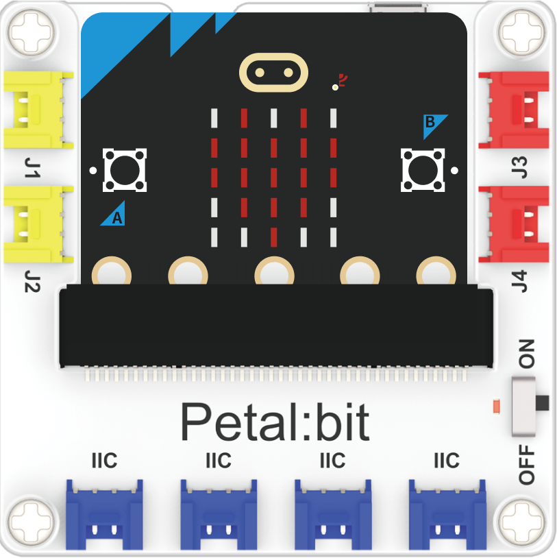
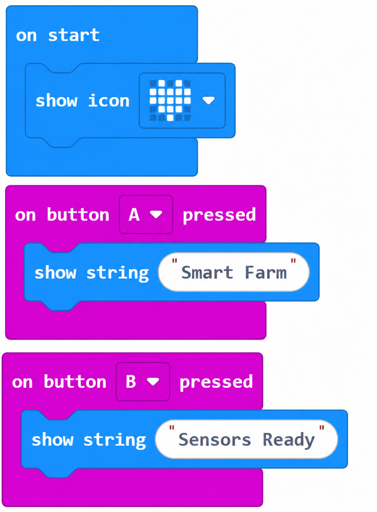
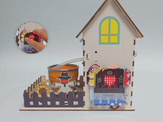

# 案例01：智能温室 · 搭建初体验

## 简介

完成温室物理组装，并编写第一段程序：开机显示农场图标，按 A 键滚动"Smart Farm"，按 B 键显示"Sensors Ready"，作为"搭建完成"的欢迎仪式。

## 教学目标

1. 认识套装结构与各硬件所在接口。

2. 完成温室静态组装并通电自检。

3. 掌握 micro:bit 显示图标与按钮交互的基础编程。

## 教学准备

| 图片 | 名称 | 数量 | 备注 |
| --- | --- | --- | --- |
|  | 未来农场套装 | 1 | 含椴木结构件 |
|  | micro:bit | 1 | 自行准备 |
|  | PC | 1 | 自行准备 |

## 课程引入

真正的农场在播种前要先搭好大棚。我们的"智能温室"也一样——先把骨架和硬件装好，再让程序赋予它"生命"。想一想：组装完成后的第一件事，用什么方式告诉别人"我准备好了"最有趣？

## 项目制作

### 硬件连接

将 micro:bit 连接到花瓣基础扩展板上。

### 编程平台

图形化编程平台 [MakeCode](https://makecode.microbit.org/)：[https://makecode.microbit.org/](https://makecode.microbit.org/)

### 新建项目

1. 打开 [https://makecode.microbit.org/](https://makecode.microbit.org/)

   

2. 点 **New Project** 新建项目

   

3. 输入项目名称（如 `smart_farm_01`）并点 **Create**

   

### 添加软件库

1. 在 MakeCode 编程界面的 Toolbox 点击 **Extensions**

   

2. 在弹出页面搜索 `petal`

   

3. 选择 petal 软件库（图标带 ELECFREAKS 标识）

### 编写程序

点击下方预览直接查看/运行完整程序；也可点击链接在 MakeCode 编辑器中打开并改造：

    <iframe
        title="智能温室 · 搭建初体验 MakeCode 示例程序"
        src="https://makecode.microbit.org/S07013-71294-18599-42695?lang=zh-CN&embed=1"
        frameBorder="0"
        sandbox="allow-popups allow-forms allow-scripts allow-same-origin"
        style={{ position: 'absolute', width: '100%', height: '100%' }}
    />

**MakeCode 分享链接**：[https://makecode.microbit.org/S07013-71294-18599-42695](https://makecode.microbit.org/S07013-71294-18599-42695)

> 你也可以通过以下网页直接下载程序到 micro:bit。

### 如何将程序下载到 micro:bit？

1. 使用 USB 线连接 PC 和 micro:bit V2。

2. 连接成功后，电脑上会识别出一个名为 `MICROBIT` 的盘符。

3. 在 MakeCode 左下角点 `...` → 选择 **Connect Device**。

4. 在弹窗里点 **Next**。

5. 在 micro:bit 上按住背面按钮不放，屏幕出现 "PAIRING MODE" 时松开；回到网页点 **Pair**，从列表选 `BBC micro:bit CMSIS-DAP` 后点 **连接**。

6. 最后点 **Download** 把程序下载到 micro:bit。

### 结果

开机后，micro:bit 显示农场图标；按 A 键滚动显示 "Smart Farm"；按 B 键显示 "Sensors Ready"。

## 扩展知识

温室，是人类为了“驯服气候”而发明的最古老也最现代的农业工具之一。从古罗马的云母窗到今天的光伏智能温室，它承载着人类突破自然约束、稳定获取食物的梦想。以下从多个维度解析设施农业的演变与意义：

一、温室技术的发展简史 
古代雏形：古罗马人用云母板覆盖以保温种植黄瓜；现代农业温室源于 17 世纪欧洲贵族的“橘园”（orangerie），用以让柑橘越冬。 
工业化转折：19 世纪工业革命带来廉价玻璃与钢铁，1851 年伦敦水晶宫展示了大跨度透光结构；20 世纪荷兰以连栋玻璃温室引领全球设施农业。 
智能化当代：如今温室集成传感器、自动通风、补光与水肥一体化，成为“会思考的建筑”。

二、温室对作物生长的革命性意义 
突破季节：温带地区冬季也能生产番茄、草莓，实现全年供应。 
提升单产：单位面积产量可达露地栽培的 5~10 倍（荷兰番茄温室每平米年产超 70 公斤）。 
节水节肥：封闭循环系统使水肥利用率提高 30%~50%，大幅减少面源污染。

三、都市农业与食品安全 
城市近郊温室缩短“从田间到餐桌”的距离，降低运输损耗与碳排放。 
社区农场、校园温室让居民与学生直接参与食物生产，重建人与食物的联系。 
特殊时期（如疫情封控），本地化生产凸显了供应链的韧性价值。

四、温室的环境效益与挑战 
效益：可控环境降低病害，减少农药使用；稳定产出，保护野生土地不被开垦。 
挑战：传统温室能耗高（冬季加温、夏季降温）；一次性塑料薄膜造成污染；初始投入门槛较高。 
应对：光伏温室、地热加温、可回收板材（如本套装采用的椴木板结构）正在降低环境足迹。

五、未来趋势 
垂直农业：在多层架子上用 LED 补光种植，单位体积产量极高，适合城市楼宇。 
植物工厂：全人工环境、无菌生产，日本、新加坡已有成熟商业化案例。 
数字孪生：用虚拟模型预测作物生长，提前调控环境参数，把“经验种地”变成“算法种地”。

总结：温室从“保暖的屋子”进化为“数据驱动的农业引擎”。今天你亲手搭建的这座智能温室，正是这场农业革命的最小缩影。正如联合国粮农组织（FAO）所言：“在有限的土地上养活增长的人口，设施农业是关键答案之一。”
