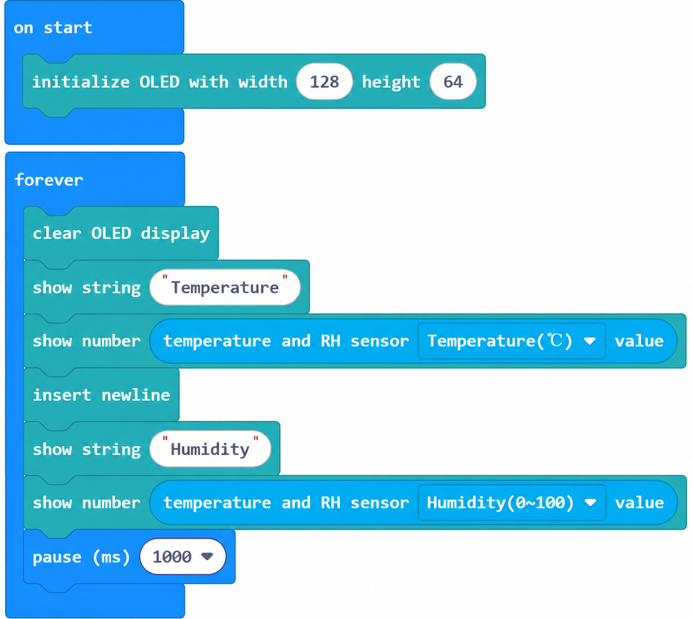
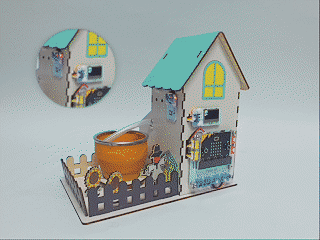

# 案例03：温室气象站 · 温湿度实时监测

## 简介

用 IIC 温湿度传感器读取空气温度与湿度，在 OLED 上分栏显示，打造迷你气象站。

## 教学目标

1. 读取 `温湿度传感器 温度(℃) 值` 与 `湿度(%) 值`。

2. 在 OLED 上分栏展示两项数据。

## 教学准备

| 图片 | 名称 | 数量 | 备注 |
| --- | --- | --- | --- |
|  | 未来农场套装 | 1 | 含椴木结构件 |
|  | micro:bit | 1 | 自行准备 |
|  | PC | 1 | 自行准备 |

## 课程引入

大棚里最该盯紧的两个数字是温度和湿度。太热或太湿，作物都容易生病。把它们放在屏幕上，就像给温室装了一块"健康看板"。

## 项目制作

### 硬件连接

按本课「教学准备」表格把对应模块接到 micro:bit 花瓣扩展板指定接口（J1/J2/J3/J4 或 IIC）。

### 编程平台

图形化编程平台 [MakeCode](https://makecode.microbit.org/)：[https://makecode.microbit.org/](https://makecode.microbit.org/)

### 新建项目

1. 打开 [https://makecode.microbit.org/](https://makecode.microbit.org/)

   

2. 点 **New Project** 新建项目

   

3. 输入项目名称（如 `smart_farm_03`）并点 **Create**

   

### 添加软件库

1. 在 MakeCode 编程界面的 Toolbox 点击 **Extensions**

   

2. 在弹出页面搜索 `petal`

   

3. 选择 petal 软件库（图标带 ELECFREAKS 标识）

### 编写程序

点击下方预览直接查看/运行完整程序；也可点击链接在 MakeCode 编辑器中打开并改造：

    <iframe
        title={"案例03：温室气象站 · 温湿度实时监测 MakeCode 示例程序"}
        src="https://makecode.microbit.org/_gpq3TD447FP7?lang=zh-CN&embed=1"
        frameBorder="0"
        sandbox="allow-popups allow-forms allow-scripts allow-same-origin"
        style={{ position: 'absolute', width: '100%', height: '100%' }}
    />

**MakeCode 分享链接**：[https://makecode.microbit.org/_gpq3TD447FP7](https://makecode.microbit.org/_gpq3TD447FP7)

> 你也可以通过以下网页直接下载程序到 micro:bit。

### 如何将程序下载到 micro:bit？

1. 使用 USB 线连接 PC 和 micro:bit V2。

2. 连接成功后，电脑上会识别出一个名为 `MICROBIT` 的盘符。

3. 在 MakeCode 左下角点 `...` → 选择 **Connect Device**。

4. 在弹窗里点 **Next**。

5. 在 micro:bit 上按住背面按钮不放，屏幕出现 "PAIRING MODE" 时松开；回到网页点 **Pair**，从列表选 `BBC micro:bit CMSIS-DAP` 后点 **连接**。

6. 最后点 **Download** 把程序下载到 micro:bit。

## 结果

OLED 顶部显示温度，底部显示湿度，每秒刷新一次。

## 扩展知识

气象，是地球大气的运动日记；而温湿度，是这本日记里与人类健康、农业生产最息息相关的两页。我们的温室气象站，就是一个微缩的气候观测台。以下从多个维度解析气象与微气候的影响：

一、温湿度对人体舒适的影响

舒适区间：医学与建筑学通常认为，人体最舒适的空气温度约 20~25℃、相对湿度 40%，“城市热岛”效应显著改变局部体感。

二、气象与农业生产

靠天吃饭到知天而作：霜冻、连阴雨、干热风是三大农业气象灾害。提前获知温湿度趋势，可抢收、覆膜、排涝。

积温与物候：作物需要累积一定温度才能成熟（如水稻全生育期约需 2000~3000℃·日），气象站数据正是农时的“计算器”。

病虫害预测：高湿环境利于真菌繁殖，气象数据可提前预警白粉病、霜霉病爆发。

三、极端天气与气候变化

频发的极端事件：近几十年，暴雨、干旱、热浪强度与频率明显上升，IPCC 报告指出人类活动是主因。

农业脆弱性：全球约 1/3 粮食产区面临气候风险，小农户首当其冲。

适应策略：耐逆品种、保水耕作、气候智慧型农业（CSA）成为应对方向。

四、气象监测技术演进

从看云识天到卫星网格：古代靠物候与经验，现代有地面站、雷达、气象卫星组成的立体观测网。

微型传感器普及：像本套装的温湿度模块，把专业监测降到学生可上手的成本，是“公民科学”的基石。

开放数据：各国气象局免费开放数据，开发者可据此开发种植、出行、能源类应用。

五、个人与社区的应对

家庭可放置温湿度计，关注老人儿童房间湿度，冬季加湿、梅雨季除湿。

社区应完善排水与遮荫设施，缓解热岛；学校可建气象角，培养学生数据素养。

个人减排（绿色出行、节约能源）是减缓气候变化的根本行动之一。

总结：气象站测的不仅是数字，更是人与自然关系的晴雨表。你今天记录的第一组数据，和全球气象网里的每一帧，本质都在回答同一个问题——我们如何与大气共处。
