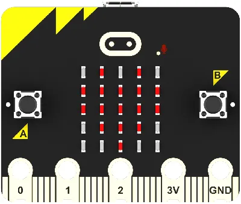
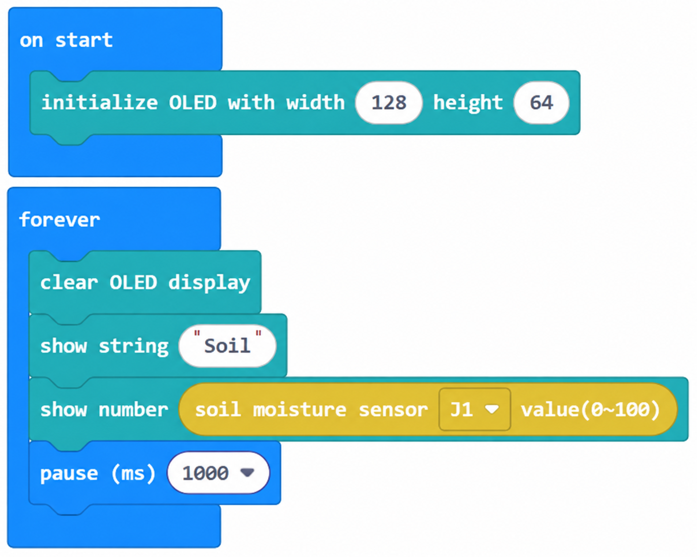
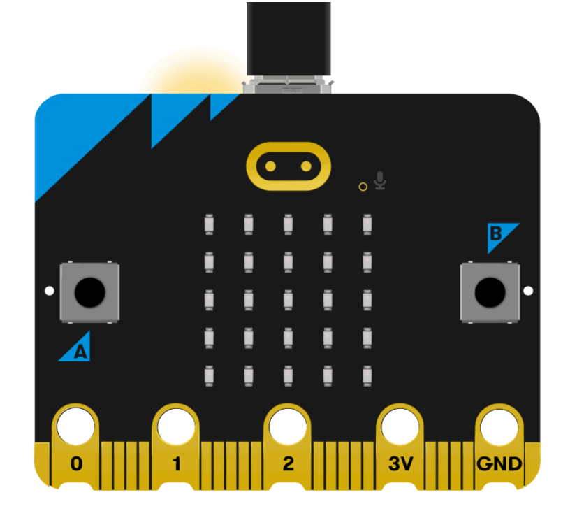
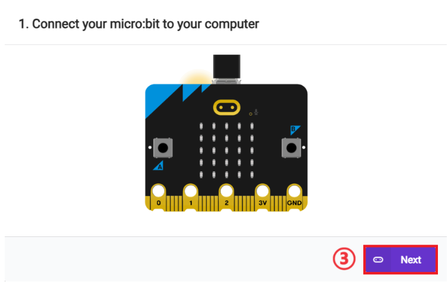
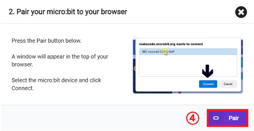
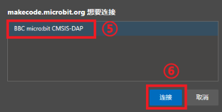
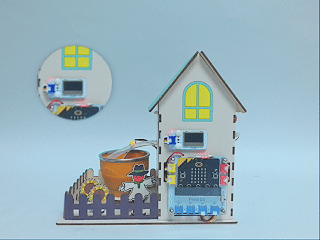

# 案例04：土壤监测 · 土壤的"口渴指数"

## 简介

把土壤湿度传感器（J1）插入基质，读取 0-100 的湿度值并显示在 OLED 上，直观判断作物是否缺水。

## 教学目标

1. 读取 `土壤湿度传感器 J1 湿度值(0-100)`。

2. 理解湿度值与"干/湿"的对应关系。

## 教学准备

| 图片 | 名称 | 数量 | 备注 |
| --- | --- | --- | --- |
|  | 未来农场套装 | 1 | 含椴木结构件 |
|  | micro:bit | 1 | 自行准备 |
|  | PC | 1 | 自行准备 |

## 课程引入

人渴了会喝水，土壤"渴了"作物就蔫。用手摸土判断干湿不精确，用传感器读数值才科学。试试用浇水前后读数变化，理解什么是"口渴指数"。

## 项目制作

### 硬件连接

按本课「教学准备」表格把对应模块接到 micro:bit 花瓣扩展板指定接口（J1/J2/J3/J4 或 IIC）。

### 编程平台

图形化编程平台 [MakeCode](https://makecode.microbit.org/)：[https://makecode.microbit.org/](https://makecode.microbit.org/)

### 新建项目

1. 打开 [https://makecode.microbit.org/](https://makecode.microbit.org/)

   

2. 点 **New Project** 新建项目

   

3. 输入项目名称（如 `smart_farm_04`）并点 **Create**

   

### 添加软件库

1. 在 MakeCode 编程界面的 Toolbox 点击 **Extensions**

   

2. 在弹出页面搜索 `petal`

   

3. 选择 petal 软件库（图标带 ELECFREAKS 标识）

### 编写程序

点击下方预览直接查看/运行完整程序；也可点击链接在 MakeCode 编辑器中打开并改造：

    <iframe
        title={"案例04：土壤监测 · 土壤的\"口渴指数\" MakeCode 示例程序"}
        src="https://makecode.microbit.org/S67954-68312-51166-62160?lang=zh-CN&embed=1"
        frameBorder="0"
        sandbox="allow-popups allow-forms allow-scripts allow-same-origin"
        style={{ position: 'absolute', width: '100%', height: '100%' }}
    />

**MakeCode 分享链接**：[https://makecode.microbit.org/S67954-68312-51166-62160](https://makecode.microbit.org/S67954-68312-51166-62160)

> 你也可以通过以下网页直接下载程序到 micro:bit。

### 如何将程序下载到 micro:bit？

1. 使用 USB 线连接 PC 和 micro:bit V2。

2. 连接成功后，电脑上会识别出一个名为 `MICROBIT` 的盘符。

3. 在 MakeCode 左下角点 `...` → 选择 **Connect Device**。

4. 在弹窗里点 **Next**。

5. 在 micro:bit 上按住背面按钮不放，屏幕出现 "PAIRING MODE" 时松开；回到网页点 **Pair**，从列表选 `BBC micro:bit CMSIS-DAP` 后点 **连接**。

6. 最后点 **Download** 把程序下载到 micro:bit。

## 结果

OLED 实时显示土壤湿度（0-100）；浇水前后对比观察数值变化。

## 扩展知识

土壤，是地球表面最薄却最珍贵的一层“皮肤”。它形成缓慢（自然成土速率约每世纪几毫米），却支撑着人类 95% 的食物。我们的“土壤口渴指数”，正是读懂这层皮肤健康的第一步。以下从多个维度解析土壤资源的重要性与危机：

一、土壤的形成与不可替代价值

时间尺度：1 厘米肥沃表土需数百年自然演化，而流失只需一场暴雨或一次不当开垦。

生命枢纽：土壤中栖息着占地球生物多样性四分之一的微生物，分解有机质、固定养分、净化水体。

碳库功能：土壤储存的碳是大气的两倍，健康土壤是应对气候变化的重要碳汇。

二、全球土壤退化危机

惊人速度：联合国粮农组织估计，全球约 33% 的土壤已中度或严重退化，每年流失可耕土相当于一个乌克兰的耕地面积。

主要诱因：过度耕作、化肥滥用、砍伐与放牧导致侵蚀、板结、盐碱化与酸化。

连锁后果：土壤退化直接威胁粮食安全，预计到 2050 年需增产 60% 才能喂饱人口。

三、土壤墒情监测的科学原理

“口渴指数”本质：土壤湿度反映根系可吸收水分的多少；过干萎蔫、过湿缺氧烂根，适宜区间因作物而异（多数蔬菜以 60%~80% 田间持水量为佳）。

测量方式：本套装用电阻/电容式传感器读取土壤电特性来推算湿度，是低成本、可教学化的方案。

数据价值：连续监测可绘制作物“水分曲线”，指导精准灌溉，避免凭感觉浇水。

四、精准农业中的土壤管理

测土配方施肥：先化验土壤养分，再按需补给，减少浪费与面源污染。

保护性耕作：免耕、覆盖作物、轮作可提升有机质、保水保肥。

数字土壤地图：结合传感器与遥感，绘制地块级“土壤身份证”，实现因片施策。

五、保护土壤的行动

减少一次性与化学依赖，厨余堆肥还田，让有机质回到土壤。

支持生态农业产品，用消费投票保护健康土壤。

参与校园/社区土壤科普，像守护皮肤一样守护脚下的土。

总结：土壤不是“脏东西”，而是文明的底座。你按下 micro:bit 读取的那一个湿度值，连接的正是人类能否持续生存的大命题。正如一句农谚所说：“万物土中生，寸土胜寸金。”
