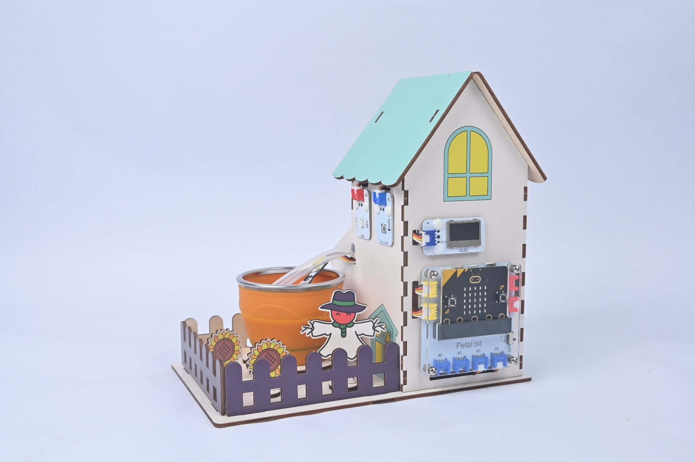
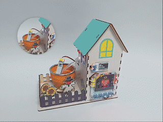

# 案例08：综合环境管家 · 本地闭环智能温室

## 简介

整合前 7 课：土壤→自动灌溉、光→自动补光、温湿度→显示+警报，形成纯本地全自动温室。

## 教学目标

1. 把多个独立案例合并为一个程序。

2. 理解多任务在 `forever` 中的协调。

## 教学准备

| 图片 | 名称 | 数量 | 备注 |
| --- | --- | --- | --- |
|  | 未来农场套装 | 1 | 含椴木结构件 |
|  | micro:bit | 1 | 自行准备 |
|  | PC | 1 | 自行准备 |

## 课程引入

单个功能像器官，组合起来才是"生命"。今天我们把眼（传感器）、手（执行器）、脑（程序）连起来，温室真正"活"了。

## 项目制作

### 硬件连接

按本课「教学准备」表格把对应模块接到 micro:bit 花瓣扩展板指定接口（J1/J2/J3/J4 或 IIC）。

### 编程平台

图形化编程平台 [MakeCode](https://makecode.microbit.org/)：[https://makecode.microbit.org/](https://makecode.microbit.org/)

### 新建项目

1. 打开 [https://makecode.microbit.org/](https://makecode.microbit.org/)

   

2. 点 **New Project** 新建项目

   

3. 输入项目名称（如 `smart_farm_08`）并点 **Create**

   

### 添加软件库

1. 在 MakeCode 编程界面的 Toolbox 点击 **Extensions**

   

2. 在弹出页面搜索 `petal`

   

3. 选择 petal 软件库（图标带 ELECFREAKS 标识）

### 编写程序

点击下方预览直接查看/运行完整程序；也可点击链接在 MakeCode 编辑器中打开并改造：

    <iframe
        title={"案例08：综合环境管家 · 本地闭环智能温室 MakeCode 示例程序"}
        src="https://makecode.microbit.org/S65394-32250-31499-11202?lang=zh-CN&embed=1"
        frameBorder="0"
        sandbox="allow-popups allow-forms allow-scripts allow-same-origin"
        style={{ position: 'absolute', width: '100%', height: '100%' }}
    />

**MakeCode 分享链接**：[https://makecode.microbit.org/S65394-32250-31499-11202](https://makecode.microbit.org/S65394-32250-31499-11202)

> 你也可以通过以下网页直接下载程序到 micro:bit。

### 如何将程序下载到 micro:bit？

1. 使用 USB 线连接 PC 和 micro:bit V2。

2. 连接成功后，电脑上会识别出一个名为 `MICROBIT` 的盘符。

3. 在 MakeCode 左下角点 `...` → 选择 **Connect Device**。

4. 在弹窗里点 **Next**。

5. 在 micro:bit 上按住背面按钮不放，屏幕出现 "PAIRING MODE" 时松开；回到网页点 **Pair**，从列表选 `BBC micro:bit CMSIS-DAP` 后点 **连接**。

6. 最后点 **Download** 把程序下载到 micro:bit。

## 结果

土壤过干自动灌溉、光照不足自动补光、温湿度实时显示、异常自动警报——一个会自我调节的温室。

## 扩展知识

自动化的核心，是让机器替我们“看—想—做”的循环持续运转。我们的综合环境管家，正是把多个传感器与执行器连成一张会自我调整的网。以下从多个维度解析闭环控制与自动化：

一、什么是闭环控制

开环与闭环：开环“发了指令就完事”（如老式定时器）；闭环则“发了指令还看结果”，用反馈不断纠偏。

经典结构：传感器测量→与设定值比较→控制器决策→执行器动作→再测量，形成回路。

生活例子：空调恒温、电饭煲保压、汽车定速巡航，全是闭环。

二、自动化在农业的应用

环境调控：温室依温湿度自动通风、补光、灌溉，恒稳在最适区间。

精准作业：无人机巡田、自动播种、机器人采摘，降低人工依赖。

全产业链：从育苗、种养到分拣、溯源，自动化贯穿始终。

三、反馈机制的科学

负反馈维稳：偏离目标就反向修正（太热则降温），是系统稳定的基石。

正反馈放大：少数场景会“越偏越远”（如病虫爆发），需人工干预打断。

延迟与震荡：浇水后土壤渗水有延迟，若采样太频繁会反复启停——“等待渗透”的设计正是为消除震荡。

四、自动化的利弊权衡

利：稳定、省工、可夜间值守、数据可追溯。

弊：初期投入高、依赖供电与网络、故障可能“ silently 失控”。

人文：过度自动化可能削弱劳作与自然的连接，需把握“辅助而非替代”。

五、未来自动化

边缘智能：数据本地即时处理，断网也能自治。

集群协同：多温室、多农场联网，统一调度水肥与能源。

人机共融：人定目标、机器执行，把决策权留在人手中。

总结：闭环不是冰冷的循环，而是把人的经验“写进”了系统。你让温室自己决定何时浇水、何时通风，本质上是在训练一个永不疲倦的“数字园丁”。正如控制论之父维纳所言：“有效的行为，来自对环境的有效反馈。”
