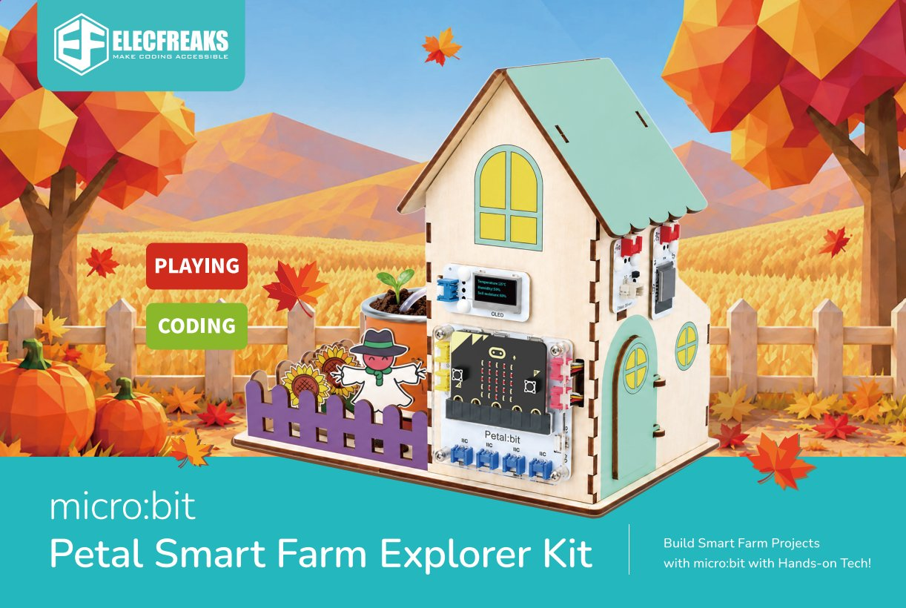
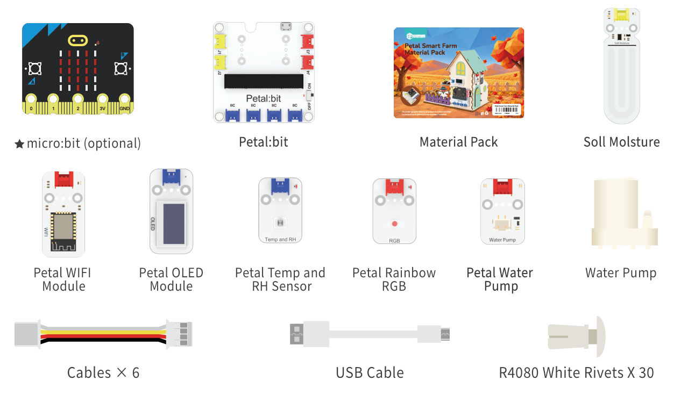

# 花瓣系列未来农场套装

## 简介

micro:bit 花瓣系列·未来农场套装

专为小学高年级至初中K12课堂与社团打造的智慧农业STEAM教学套装。以 micro:bit 为主控、以"真种植"为体验锚点、以 12 课进阶体系为教学载体，从搭建温室、种下第一颗种子，到数据上云、远程灌溉，一盒覆盖"感知—控制—物联网"完整教学链路。

**用 micro:bit 搭建你的智慧农场，在真实种植中解锁物联网与编程的奥秘！**



## 产品参数

| 项目 | 参数 |
| --- | --- |
| 产品名称 | micro:bit 花瓣系列·未来农场套装 |
| 国际产品名 | micro:bit Petal Smart Farm Explorer Kit |
| SKU | EF08458 |
| 电子模块数量 | 6个 |
| 电子模块 | 花瓣系列土壤湿度传感器、水泵模块、WiFi模块、RGB彩灯、温湿度传感器、OLED显示屏 |
| 结构件 | 椴木板（环保可回收）、折叠种植杯、尼龙铆钉 |
| 适用年龄 | 10+ |
| 案例数量 | 10+ |
| 编程方式 | MakeCode 图形化编程、Python |

## 产品清单



## 硬件介绍

### 花瓣系列土壤湿度传感器
读取土壤"口渴指数"（0-100），精准感知作物根部水分状况。搭配水泵模块实现"干则浇、湿则停"的自动灌溉闭环。

### 花瓣系列水泵模块
通过 micro:bit 控制水泵启停，实现智能灌溉。支持本地自动浇水和网页端远程控制，让农场"自己会喝水"。

### 花瓣系列WiFi模块
为农场赋予联网能力——把温湿度、土壤、光照数据定时上传至云端，支持网页端远程查看数据曲线与下发控制指令。

### 花瓣系列RGB彩灯
全彩可编程灯珠，支持补光照明、状态指示与环境警报。光线不足时自动补光，温湿度异常时亮红灯提醒。

### 花瓣系列温湿度传感器
实时监测温室空气温度与湿度，为环境调控提供精准数据。搭配 OLED 显示屏与警报逻辑，打造迷你气象站。

### 花瓣系列OLED显示屏
实时显示土壤湿度、温湿度、光照强度等关键数据，将抽象信息可视化，让"看不见"的环境数据变得一目了然。

## 目录

```mdx-code-block
import DocCardList from '@theme/DocCardList';

<DocCardList />
```

## 案例目录

- [案例01：智能温室 · 搭建初体验](./case01-smart-greenhouse.md)
- [案例02：光照感知 · 光线小助手](./case02-light-monitor.md)
- [案例03：温室气象站 · 温湿度实时监测](./case03-temperature-humidity.md)
- [案例04：土壤监测 · 土壤的"口渴指数"](./case04-soil-moisture.md)
- [案例05：智能灌溉 · 土壤联动自动浇水](./case05-automatic-irrigation.md)
- [案例06：智能补光 · 光照联动彩虹灯](./case06-automatic-lighting.md)
- [案例07：环境警报 · 温湿度异常提醒](./case07-environment-alarm.md)
- [案例08：综合环境管家 · 本地闭环智能温室](./case08-smart-greenhouse-control.md)
- [案例09：数据上云 · 农场实时监测站](./case09-cloud-monitoring.md)
- [案例10：远程灌溉 · 网页端控制浇水](./case10-remote-irrigation.md)
- [案例11：全功能智慧农场 · 云端集成](./case11-connected-smart-farm.md)
- [案例12：我的智慧农场 · 创意结业展示](./case12-my-smart-farm.md)
