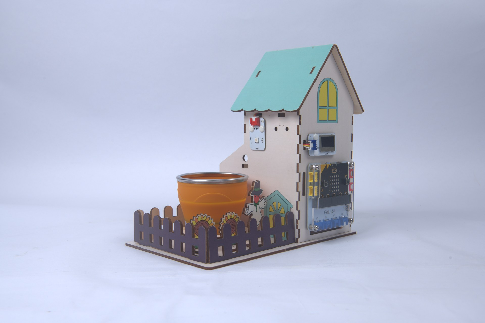
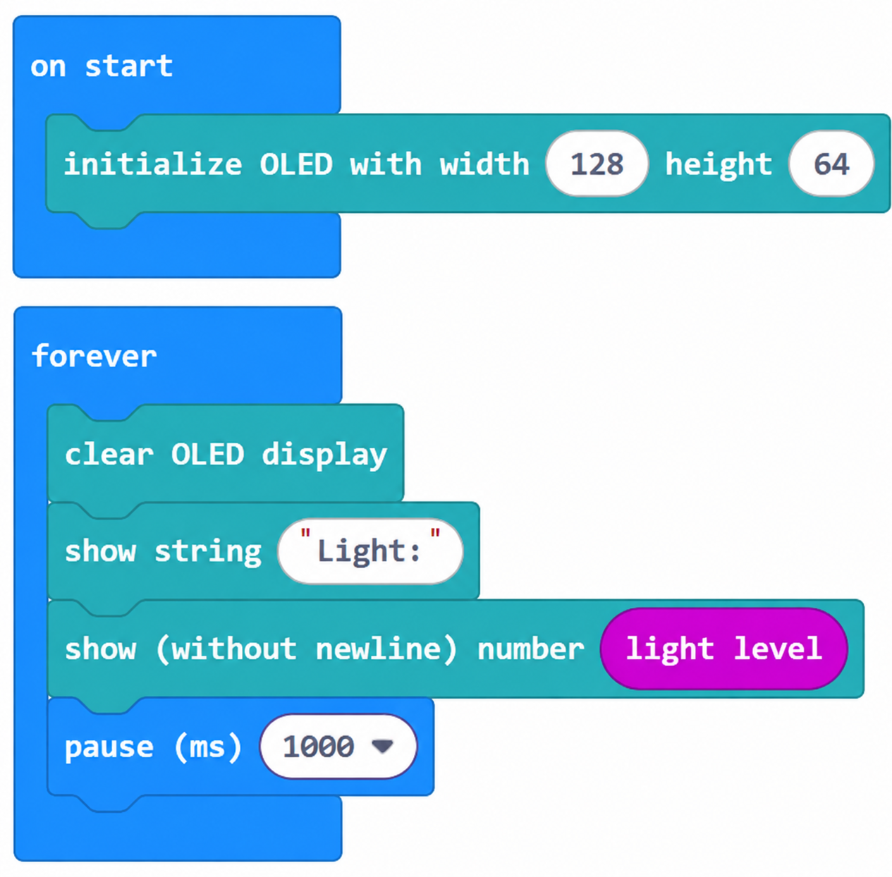
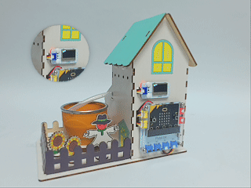

# Case 02: Light Sensing · Your Light Assistant

## Introduction

Use the micro:bit built-in light sensor to measure ambient light and display the reading on the OLED. When the light is insufficient, the RGB light turns yellow to indicate that supplementary lighting is needed.

## Learning Objectives

1. Read ambient light with `input.lightLevel()`.

2. Display a numerical reading on the OLED.

3. Use the RGB light as a status indicator.

## Teaching Preparation

| Image | Item | Quantity | Notes |
| --- | --- | --- | --- |
| | Smart Farm Explorer Kit | 1 | Includes basswood structural parts |
|  | micro:bit | 1 | Prepare separately |
|  | PC | 1 | Prepare separately |

## Lesson Introduction

Plants use light for photosynthesis. On cloudy days or indoors, weak light can leave crops short of energy. Would it help to see the light level at any time and receive a light signal when it is too dark?

## Project Implementation

### Hardware Connection

Connect the modules listed in Teaching Preparation to the designated Petal:bit ports (J1, J2, J3, J4 or IIC).

### Programming Platform

Use the graphical programming platform [MakeCode](https://makecode.microbit.org/).

### Create a New Project

1. Open [MakeCode](https://makecode.microbit.org/).

   

2. Click **New Project**.

   

3. Enter a project name, such as `smart_farm_02`, and click **Create**.

   

### Add the Extension

1. Click **Extensions** in the MakeCode toolbox.

   

2. Search for `petal`.

   

3. Select the petal extension with the ELECFREAKS logo.

### Write the Program

Use the preview below to view and run the complete program, or open the shared project in MakeCode to edit it.

    <iframe
        title={"Case 02: Light Sensing · Your Light Assistant MakeCode sample program"}
        src="https://makecode.microbit.org/_9LtTcbWdJgFJ?lang=en&embed=1"
        frameBorder="0"
        sandbox="allow-popups allow-forms allow-scripts allow-same-origin"
        style={{ position: 'absolute', width: '100%', height: '100%' }}
    />

**MakeCode project:** [https://makecode.microbit.org/_9LtTcbWdJgFJ](https://makecode.microbit.org/_9LtTcbWdJgFJ)

> You can also download the program to your micro:bit from the webpage.

### Download the Program to micro:bit

1. Connect the PC to your micro:bit V2 with a USB cable.

   

2. A drive named `MICROBIT` appears on the computer when the connection succeeds.

   

3. Click `...` at the bottom left of MakeCode, then select **Connect Device**.

   

   

4. Click **Next** in the dialog.

   

5. Hold the button on the back of the micro:bit until the display shows **PAIRING MODE**, then release it. Return to the webpage and click **Pair**. Select `BBC micro:bit CMSIS-DAP` from the list and click **Connect**.

   

   

   

   

6. Click **Download** to transfer the program to micro:bit.

   

## Result

The OLED displays the current light reading in real time. When light is insufficient (below 100 lux), the RGB light turns yellow.

## Extended Knowledge

Light supplies energy for almost all life on Earth and acts as an invisible clock for people and other organisms. The light assistant measures one part of this life-supporting environment.

### 1. Light and Human Physiology

Circadian rhythms: Light-sensitive retinal cells called ipRGCs receive blue-light signals and relay them to the body's clock in the hypothalamus, influencing melatonin. Repeated reversal of day and night can disrupt sleep and metabolism.

Mood and attention: Regions with little winter daylight, such as northern Europe, have higher rates of seasonal depression. Sufficient light supports serotonin, mood and concentration.

Vision: Natural light supports children's visual development. Studies associate around two hours outdoors each day with a lower risk of developing myopia.

### 2. Light Pollution

Excessive or poorly directed artificial lighting creates light pollution. Estimates suggest that about 80% of people live under affected skies and one-third cannot see the Milky Way with the naked eye.

City lighting can misdirect sea turtle hatchlings inland, confuse migrating birds around illuminated towers, and attract insects in ways that disrupt food webs. Poor outdoor lighting has been estimated to waste more than US$3 billion in electricity annually in the United States, together with associated emissions.

### 3. Plant Photoperiods

Short-day plants, such as chrysanthemums and soybeans, flower with shorter days and longer nights. Long-day plants, such as wheat and spinach, respond differently. Light quality also matters: red light encourages stem and leaf growth, blue affects compact growth, and far-red influences germination.

These responses underpin the kit's automatic lighting lesson. Controlling duration and spectrum can enable off-season flowering and year-round production.

### 4. Efficient, Environmentally Considerate Lighting

LEDs use around 70–80% less energy than incandescent lighting and allow control of spectrum, making them useful in plant factories. Occupancy sensing and daylight compensation reduce unnecessary lighting. Restrictions on spill light and dark-sky parks can protect ecosystems and views of the stars.

### 5. Everyday Lighting Choices

Spend time in natural daylight, particularly in the morning, to support the body clock. Reduce bright screen light at night and use dim, warm bedroom lighting. Shield outdoor fixtures so they illuminate the intended area instead of the sky.

Light is both an energy source and an ecological factor. Each reading from micro:bit offers a starting point for exploring this wider network. Darkness is also part of the rhythm of life.
