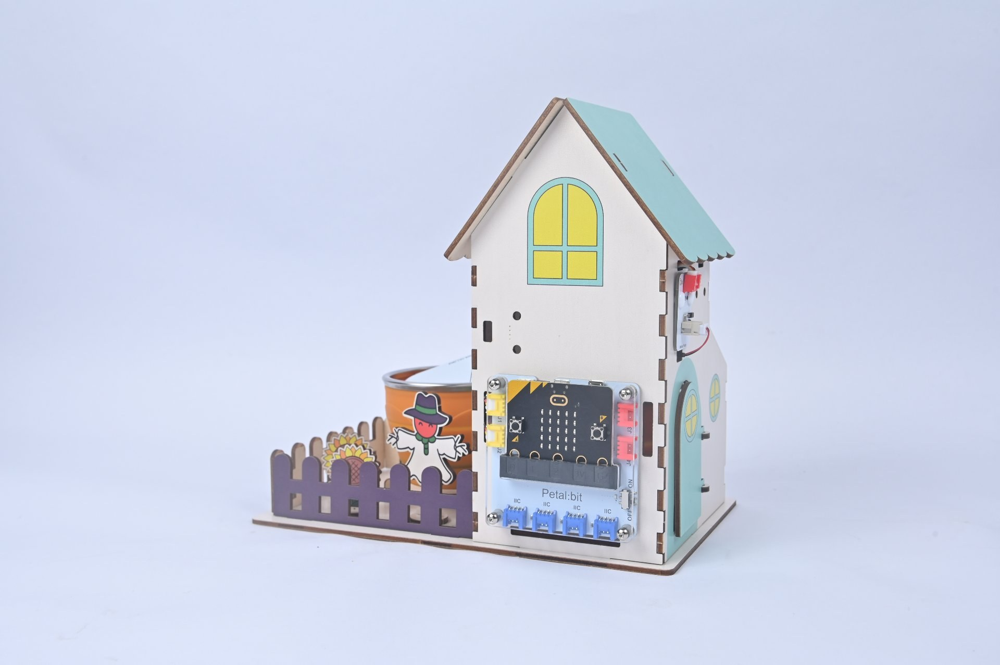
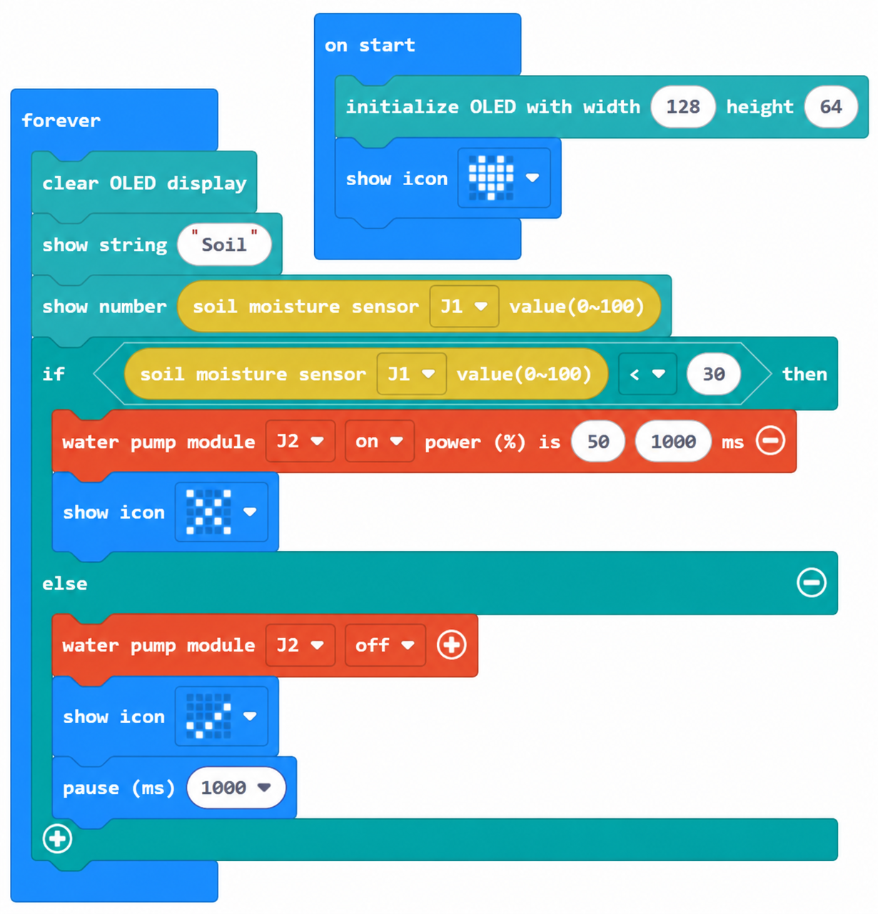
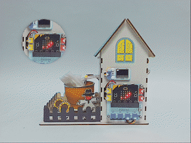

# Case 05: Automatic Irrigation · Watering by Soil Moisture

## Introduction

When soil moisture falls below the threshold, turn on the water pump connected to J2 for a few seconds, then stop it and wait for the water to soak in. This creates an automatic irrigation feedback loop.

## Learning Objectives

1. Control the pump with the water pump module J2 on/off blocks.

2. Implement the feedback sequence: low moisture → watering → waiting → stopping.

## Teaching Preparation

| Image | Item | Quantity | Notes |
| --- | --- | --- | --- |
| | Smart Farm Explorer Kit | 1 | Includes basswood structural parts |
|  | micro:bit | 1 | Prepare separately |
|  | PC | 1 | Prepare separately |

## Lesson Introduction

Farmers must water regularly, while avoiding both root damage from too much water and drought from too little. Let micro:bit become an automatic gardener: water dry soil and stop when there is enough moisture.

## Project Implementation

### Hardware Connection

Connect the modules listed in Teaching Preparation to the designated Petal:bit ports (J1, J2, J3, J4 or IIC).

### Programming Platform

Use the graphical programming platform [MakeCode](https://makecode.microbit.org/).

### Create a New Project

1. Open [MakeCode](https://makecode.microbit.org/).

   

2. Click **New Project**.

   

3. Enter a project name, such as `smart_farm_05`, and click **Create**.

   

### Add the Extension

1. Click **Extensions** in the MakeCode toolbox.

   

2. Search for `petal`.

   

3. Select the petal extension with the ELECFREAKS logo.

### Write the Program

Use the preview below to view and run the complete program, or open the shared project in MakeCode to edit it.

    <iframe
        title={"Case 05: Automatic Irrigation · Watering by Soil Moisture MakeCode sample program"}
        src="https://makecode.microbit.org/S07385-00120-67972-25420?lang=en&embed=1"
        frameBorder="0"
        sandbox="allow-popups allow-forms allow-scripts allow-same-origin"
        style={{ position: 'absolute', width: '100%', height: '100%' }}
    />

**MakeCode project:** [https://makecode.microbit.org/S07385-00120-67972-25420](https://makecode.microbit.org/S07385-00120-67972-25420)

> You can also download the program to your micro:bit from the webpage.

### Download the Program to micro:bit

1. Connect the PC to your micro:bit V2 with a USB cable.

   

2. A drive named `MICROBIT` appears on the computer when the connection succeeds.

   

3. Click `...` at the bottom left of MakeCode, then select **Connect Device**.

   

   

4. Click **Next** in the dialog.

   

5. Hold the button on the back of the micro:bit until the display shows **PAIRING MODE**, then release it. Return to the webpage and click **Pair**. Select `BBC micro:bit CMSIS-DAP` from the list and click **Connect**.

   

   

   

   

6. Click **Download** to transfer the program to micro:bit.

   

## Result

When soil moisture is below 30, the pump automatically waters for 3 seconds. It then waits 5 seconds for the water to soak in before checking again.

## Extended Knowledge

Water is the lifeblood of agriculture and an increasingly constrained resource. Soil-controlled automatic watering applies careful use of individual drops to a global challenge.

### 1. Global Water Resources

About 97.5% of Earth's water is saline and only 2.5% is fresh; readily available river and lake water is a small fraction. Around two billion people live in severely water-scarce areas. Earlier UN projections warned that widespread water stress would affect countries by 2025.

Pollution further reduces usable fresh water. Agricultural runoff is one cause of nutrient enrichment in rivers and lakes.

### 2. Agricultural Demand and Waste

Agriculture accounts for about 70% of global freshwater withdrawals, with a higher share in many developing countries. Traditional flood irrigation may use only 40–50% effectively, losing water through evaporation, leakage and runoff.

Watering by habit can supply too much, waste water, damage roots and encourage disease.

### 3. Water-Saving Irrigation

Drip systems deliver water near roots and can exceed 90% efficiency; they have helped support productive agriculture in dry regions such as Israel. Sprinklers and micro-sprinklers imitate rainfall and can save 30–50% compared with flood irrigation.

Sensor-controlled watering, as demonstrated in this kit, starts a pump when moisture is low and supplies water according to need.

### 4. Economic and Ecological Benefits

Automation reduces manual inspections, while fertigation can deliver nutrients with water. Lower river withdrawals and drainage discharges benefit downstream wetlands and fish. Precise irrigation also helps crops withstand critical dry periods and stabilizes yields.

### 5. Everyday Water Conservation

Collect rainwater for suitable gardening uses and reuse appropriate household water. Choose efficient fixtures and shorter showers. Support agricultural products associated with efficient water use.

Each accurately delivered drop improves our use of a shared resource. The simple rule to start the pump when dry and stop when wet illustrates responsibility to future generations.
