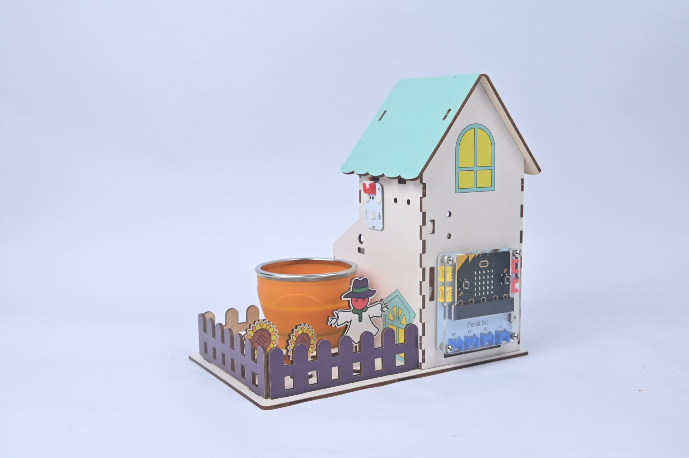
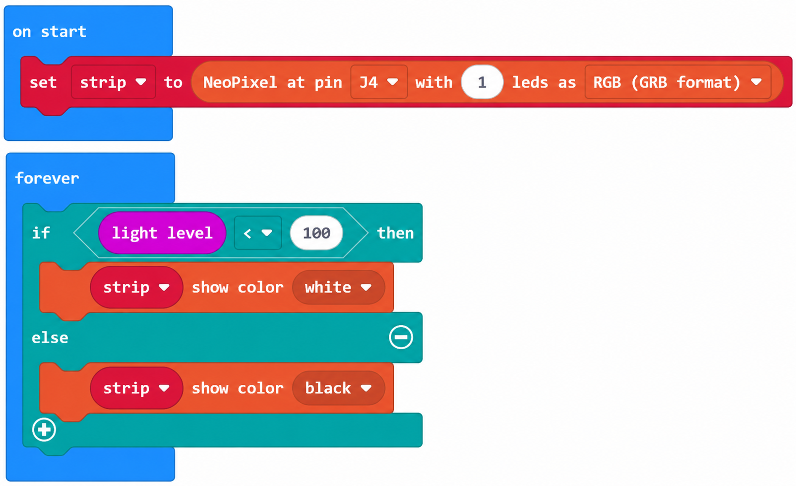
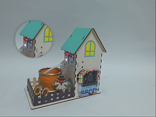

# Case 06: Automatic Lighting · Light-Controlled Rainbow RGB

## Introduction

Automatically turn on the RGB light when ambient light is insufficient and switch it off when the surroundings are bright enough, modeling supplementary lighting in a modern greenhouse.

## Learning Objectives

1. Combine the light sensor and RGB light again.

2. Understand the automation rule: insufficient light → turn on the light.

## Teaching Preparation

| Image | Item | Quantity | Notes |
| --- | --- | --- | --- |
| | Smart Farm Explorer Kit | 1 | Includes basswood structural parts |
|  | micro:bit | 1 | Prepare separately |
|  | PC | 1 | Prepare separately |

## Lesson Introduction

Short winter days can limit crop growth. Greenhouses use supplementary lights as artificial suns. We will make the RGB light turn on automatically in the dark, like switching on a desk lamp for a plant.

## Project Implementation

### Hardware Connection

Connect the modules listed in Teaching Preparation to the designated Petal:bit ports (J1, J2, J3, J4 or IIC).

### Programming Platform

Use the graphical programming platform [MakeCode](https://makecode.microbit.org/).

### Create a New Project

1. Open [MakeCode](https://makecode.microbit.org/).

   

2. Click **New Project**.

   

3. Enter a project name, such as `smart_farm_06`, and click **Create**.

   

### Add the Extension

1. Click **Extensions** in the MakeCode toolbox.

   

2. Search for `petal`.

   

3. Select the petal extension with the ELECFREAKS logo.

### Write the Program

Use the preview below to view and run the complete program, or open the shared project in MakeCode to edit it.

    <iframe
        title={"Case 06: Automatic Lighting · Light-Controlled Rainbow RGB MakeCode sample program"}
        src="https://makecode.microbit.org/_doMbueU2MRCo?lang=en&embed=1"
        frameBorder="0"
        sandbox="allow-popups allow-forms allow-scripts allow-same-origin"
        style={{ position: 'absolute', width: '100%', height: '100%' }}
    />

**MakeCode project:** [https://makecode.microbit.org/_doMbueU2MRCo](https://makecode.microbit.org/_doMbueU2MRCo)

> You can also download the program to your micro:bit from the webpage.

### Download the Program to micro:bit

1. Connect the PC to your micro:bit V2 with a USB cable.

   

2. A drive named `MICROBIT` appears on the computer when the connection succeeds.

   

3. Click `...` at the bottom left of MakeCode, then select **Connect Device**.

   

   

4. Click **Next** in the dialog.

   

5. Hold the button on the back of the micro:bit until the display shows **PAIRING MODE**, then release it. Return to the webpage and click **Pair**. Select `BBC micro:bit CMSIS-DAP` from the list and click **Connect**.

   

   

   

   

6. Click **Download** to transfer the program to micro:bit.

   

## Result

When ambient light is insufficient (below 100 lux), the RGB light shines white. It switches off automatically when the light is sufficient.

## Extended Knowledge

For plants, light is the energy source used to make food through photosynthesis. Supplementary lighting supplies part of the work normally done by the sun.

### 1. The Science of Supplementary Light

Chlorophyll strongly absorbs red light around 660 nm and blue light around 450 nm. Red-blue combinations support growth, while far-red and green light also influence development.

Artificial light can extend perceived daylight and change flowering schedules, allowing growers to bring flowering forward or delay it for market timing. Crops have different light requirements; strawberries may use around 300–500 μmol/m²/s. Excess light can waste energy without improving growth.

### 2. LED Plant Factories

A plant factory is a controlled growing space in which LEDs replace sunlight and nutrient solution can replace soil. Examples include Japan's Spread, the Netherlands' PlantLab, and urban vegetable production in Singapore.

These systems can operate throughout the year, avoid occupying fertile farmland, reduce pesticide needs, and produce many times the output per unit footprint of open fields.

### 3. Growing in Special Environments

Red and blue LEDs have supported lettuce growing on the International Space Station, providing fresh food and a connection to living plants. Supplementary lighting can also help polar stations, remote islands and ocean-going vessels reduce dependence on supplies.

Disused factories and underground shelters can become urban farms, reusing spaces within the food system.

### 4. Energy and Sustainability

Electricity can account for around 60–80% of plant-factory costs, making LED efficiency and renewable power important. Electricity emissions must be balanced against reductions in transport and refrigeration; the overall outcome depends on the system.

LED waste heat can be recovered for heating. Closed nutrient-solution loops can reduce water use by more than 90%.

### 5. Future Directions

Tunable spectra may help produce crops with selected characteristics, such as tomatoes rich in lycopene. AI can adjust lighting to measured growth. Small home plant factories may become kitchen appliances.

Supplementary lighting extends the possibilities of sunlight. Making an RGB light respond to darkness is a small experiment in giving plants the light they need.
