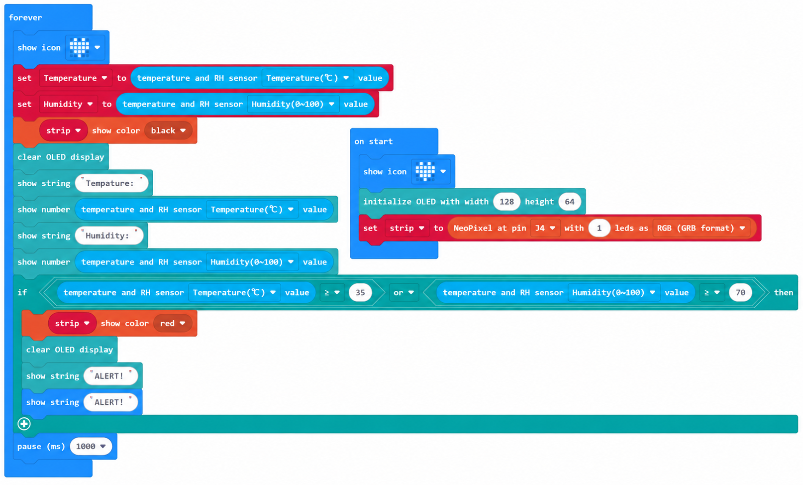

# Case 07: Environmental Alarm · Temperature and Humidity Alerts

## Introduction

When temperature or humidity exceeds the safe range, turn the RGB light red, display an alert on the OLED, and play a built-in melody.

## Learning Objectives

1. Combine the temperature and RH sensor, RGB, OLED and built-in `music` features into an alarm.

2. Understand logical OR with multiple conditions.

## Teaching Preparation

| Image | Item | Quantity | Notes |
| --- | --- | --- | --- |
| | Smart Farm Explorer Kit | 1 | Includes basswood structural parts |
|  | micro:bit | 1 | Prepare separately |
|  | PC | 1 | Prepare separately |

## Lesson Introduction

A greenhouse that becomes too hot or damp needs immediate attention. Red light, text and music provide three ways for its manager to notice an abnormal condition.

## Project Implementation

### Hardware Connection

Connect the modules listed in Teaching Preparation to the designated Petal:bit ports (J1, J2, J3, J4 or IIC).

### Programming Platform

Use the graphical programming platform [MakeCode](https://makecode.microbit.org/).

### Create a New Project

1. Open [MakeCode](https://makecode.microbit.org/).

   

2. Click **New Project**.

   

3. Enter a project name, such as `smart_farm_07`, and click **Create**.

   

### Add the Extension

1. Click **Extensions** in the MakeCode toolbox.

   

2. Search for `petal`.

   

3. Select the petal extension with the ELECFREAKS logo.

### Write the Program

Use the preview below to view and run the complete program, or open the shared project in MakeCode to edit it.

    <iframe
        title={"Case 07: Environmental Alarm · Temperature and Humidity Alerts MakeCode sample program"}
        src="https://makecode.microbit.org/S62425-59545-55623-68126?lang=en&embed=1"
        frameBorder="0"
        sandbox="allow-popups allow-forms allow-scripts allow-same-origin"
        style={{ position: 'absolute', width: '100%', height: '100%' }}
    />

**MakeCode project:** [https://makecode.microbit.org/S62425-59545-55623-68126](https://makecode.microbit.org/S62425-59545-55623-68126)

> You can also download the program to your micro:bit from the webpage.

### Download the Program to micro:bit

1. Connect the PC to your micro:bit V2 with a USB cable.

   

2. A drive named `MICROBIT` appears on the computer when the connection succeeds.

   

3. Click `...` at the bottom left of MakeCode, then select **Connect Device**.

   

   

4. Click **Next** in the dialog.

   

5. Hold the button on the back of the micro:bit until the display shows **PAIRING MODE**, then release it. Return to the webpage and click **Pair**. Select `BBC micro:bit CMSIS-DAP` from the list and click **Connect**.

   

   

   

   

6. Click **Download** to transfer the program to micro:bit.

   

## Result

When temperature is above 30°C or humidity is above 80%, the RGB light turns red, the OLED displays "ALERT!", and a built-in melody plays.

## Extended Knowledge

Alarms give people time to respond to uncertainty, from ancient beacon towers to smoke detectors. The greenhouse environmental alarm applies the same idea to growing conditions.

### 1. The Social Value of Early Warning

Early warnings can turn sudden hazards into events for which people prepare. Typhoon forecasts allow coastal evacuation. Frost and heavy-rain alerts give farmers time to harvest, cover plants or protect fields, potentially saving a substantial share of a crop. Reliable warnings also support public trust and reduce rumors and panic.

### 2. Extreme Weather Warnings

China uses blue, yellow, orange and red warning levels, with increasing urgency and corresponding responses. Seedlings are sensitive to sudden cold; prolonged humidity encourages disease; hot dry winds can force premature ripening. Each needs an appropriate warning.

Satellites, radar and automatic stations provide frequent observations, while AI models can improve short-term forecasts.

### 3. Warnings for Agricultural Hazards

Dry soil can trigger an irrigation reminder; excessive moisture can trigger drainage advice to protect roots and prevent lodging. Temperature, humidity and historical records can help predict windows for powdery mildew or aphid outbreaks days in advance. Strong-wind warnings can prompt reinforcement of greenhouse structures and coverings.

### 4. Warning System Architecture

The sensing layer measures the environment using temperature, humidity, soil or light sensors. The transmission layer carries readings by wired or wireless links to a controller or cloud service. The decision layer compares readings with thresholds—for example, an alarm above 35°C—and triggers light, sound or messages.

This is the sensing → judgment → notification sequence built in this lesson.

### 5. Public Participation and Understanding

Learn to recognize warning signals and icons, including the possibility that a low-level warning may escalate. School warning stations can teach the engineering relationship between a threshold and a response. Community drills help ensure that warnings lead to action rather than becoming background noise.

The most useful alarm leaves time to act. Your micro:bit warning and a weather service alert share the same principle: earlier awareness creates more opportunities to stay safe.
