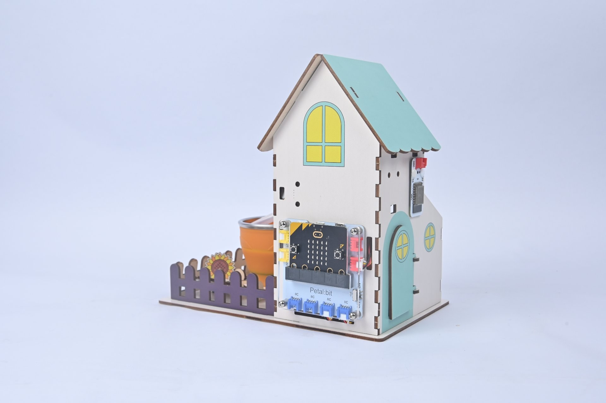
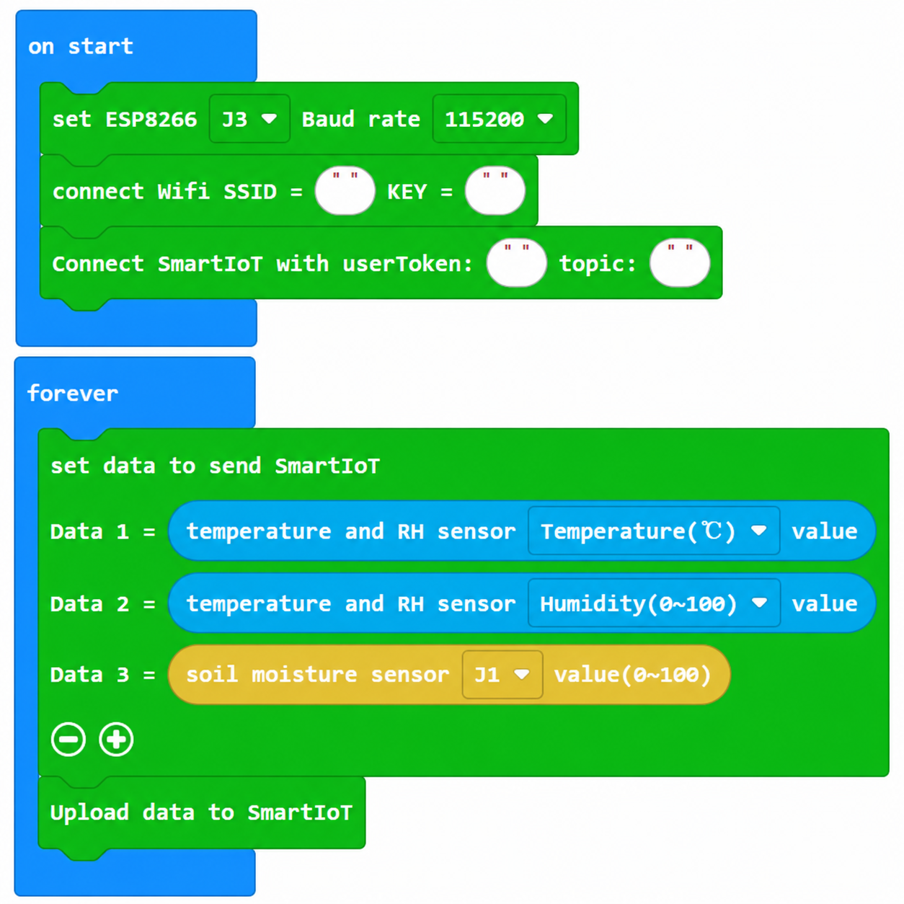
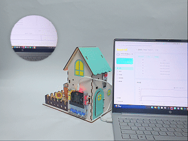

# Case 09: Data to the Cloud · Live Farm Monitoring

## Introduction

Configure the WiFi module on J3 and regularly upload temperature, humidity, soil moisture and light readings to the SmartIoT web platform for cloud monitoring and charts.

## Learning Objectives

1. Connect the WiFi module on J3 to a WiFi network using its SSID and password.

2. Regularly upload a topic and data through the WiFi module to the platform.

## Teaching Preparation

| Image | Item | Quantity | Notes |
| --- | --- | --- | --- |
| | Smart Farm Explorer Kit | 1 | Includes basswood structural parts |
|  | micro:bit | 1 | Prepare separately |
|  | PC | 1 | Prepare separately |

## Lesson Introduction

Displaying data on a local screen is only the beginning. Upload it to the cloud so teachers and parents can view its charts on the web at any time. This is an Internet of Things farm.

## Project Implementation

### Hardware Connection

Connect the modules listed in Teaching Preparation to the designated Petal:bit ports (J1, J2, J3, J4 or IIC).

### Programming Platform

Use the graphical programming platform [MakeCode](https://makecode.microbit.org/).

### Create a New Project

1. Open [MakeCode](https://makecode.microbit.org/).

   

2. Click **New Project**.

   

3. Enter a project name, such as `smart_farm_09`, and click **Create**.

   

### Add the Extension

1. Click **Extensions** in the MakeCode toolbox.

   

2. Search for `petal`.

   

3. Select the petal extension with the ELECFREAKS logo.

### Write the Program

Use the preview below to view and run the complete program, or open the shared project in MakeCode to edit it.

    <iframe
        title={"Case 09: Data to the Cloud · Live Farm Monitoring MakeCode sample program"}
        src="https://makecode.microbit.org/S33971-35077-49390-44135?lang=en&embed=1"
        frameBorder="0"
        sandbox="allow-popups allow-forms allow-scripts allow-same-origin"
        style={{ position: 'absolute', width: '100%', height: '100%' }}
    />

**MakeCode project:** [https://makecode.microbit.org/S33971-35077-49390-44135](https://makecode.microbit.org/S33971-35077-49390-44135)

> You can also download the program to your micro:bit from the webpage.

### Download the Program to micro:bit

1. Connect the PC to your micro:bit V2 with a USB cable.

   

2. A drive named `MICROBIT` appears on the computer when the connection succeeds.

   

3. Click `...` at the bottom left of MakeCode, then select **Connect Device**.

   

   

4. Click **Next** in the dialog.

   

5. Hold the button on the back of the micro:bit until the display shows **PAIRING MODE**, then release it. Return to the webpage and click **Pair**. Select `BBC micro:bit CMSIS-DAP` from the list and click **Connect**.

   

   

   

   

6. Click **Download** to transfer the program to micro:bit.

   

## Result

Every 5 seconds, upload four readings—temperature, humidity, soil moisture and light—to SmartIoT, where live charts can be viewed in a browser.

## Extended Knowledge

The Internet of Things (IoT) connects objects so they can share information. Uploading farm readings to the cloud is a practical example of this idea.

### 1. IoT Concepts and Architecture

A four-layer model includes sensing (sensors), networking (WiFi or cellular links), platforms (cloud storage and computation), and applications (dashboards and decisions). Its features include broad sensing, reliable transmission, intelligent processing and proactive services.

Estimates have put connected devices above 15 billion, with projections of further rapid growth. Agriculture is an important application area.

### 2. Digital Agriculture Applications

Precision growing combines field-level weather, soil and crop-growth data to produce irrigation and fertilizer recommendations. Livestock collars can monitor location, temperature and rumination to help identify illness early.

Traceability systems record the journey from sowing to the table so consumers can inspect information by scanning a code. Recorded conditions can also support evidence-based insurance assessments.

### 3. The Value of Agricultural Data

Historical records reveal relationships among varieties, climate and yields, helping growers select crops and schedules. Weather and crop-development models can support yield and hazard forecasts and reduce market uncertainty. Repeated records of water, fertilizer and labor use help improve quality and efficiency over time.

### 4. Security and Privacy

A compromised device could issue incorrect control actions. Leaked location or yield data could affect a farm's business. Strong passwords, firmware updates, minimum necessary permissions and encrypted transmission reduce risk.

Clear rules and consent are needed to define who owns data and who may use it.

### 5. Challenges and Future Development

Remote fields may have poor coverage, creating a role for low-power wide-area networks such as LoRa and NB-IoT. Incompatible vendor protocols create data silos. Affordable systems and understandable interfaces are essential if smallholders are to benefit.

Uploading data is a means to informed action. Your first uploaded reading is a small step toward understanding agriculture through connected observations.
