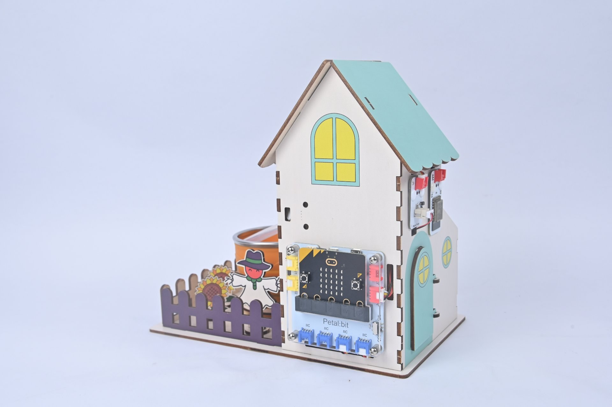
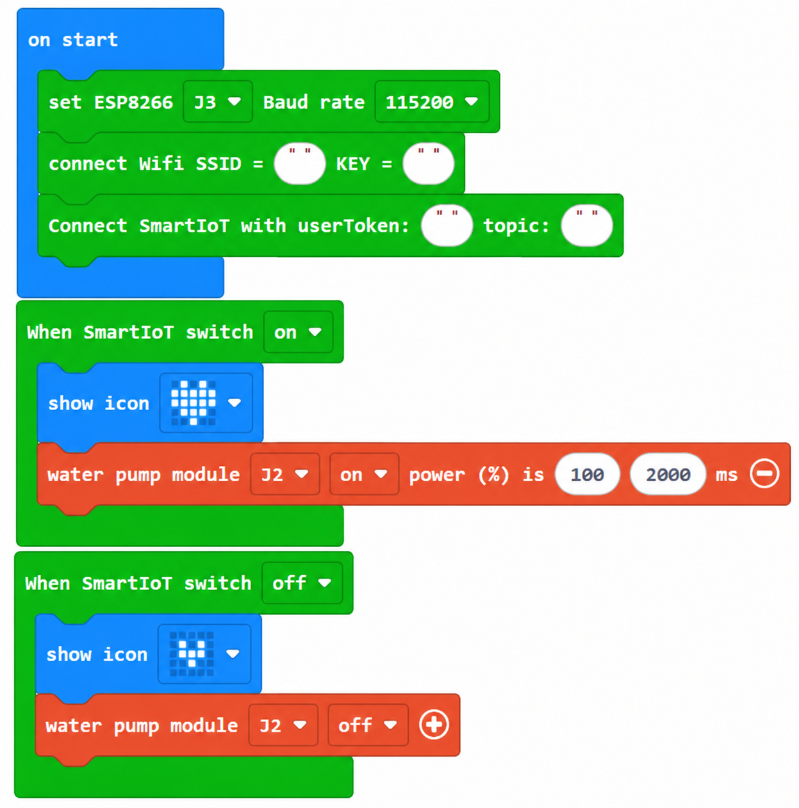
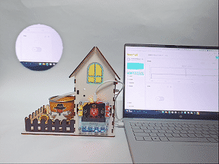

# Case 10: Remote Irrigation · Watering from the Web

## Introduction

Create a remote switch on the SmartIoT web platform and send commands to start or stop the local water pump on J2, even when you are away from the farm.

## Learning Objectives

1. Receive platform commands through the WiFi module J3 event handler.

2. Use incoming commands to turn the J2 water pump on or off.

## Teaching Preparation

| Image | Item | Quantity | Notes |
| --- | --- | --- | --- |
| | Smart Farm Explorer Kit | 1 | Includes basswood structural parts |
|  | micro:bit | 1 | Prepare separately |
|  | PC | 1 | Prepare separately |

## Lesson Introduction

Forgot to water before going out? Tap a control on a phone or computer webpage and the farm at home can water itself. That is the appeal of remote control.

## Project Implementation

### Hardware Connection

Connect the modules listed in Teaching Preparation to the designated Petal:bit ports (J1, J2, J3, J4 or IIC).

### Programming Platform

Use the graphical programming platform [MakeCode](https://makecode.microbit.org/).

### Create a New Project

1. Open [MakeCode](https://makecode.microbit.org/).

   

2. Click **New Project**.

   

3. Enter a project name, such as `smart_farm_10`, and click **Create**.

   

### Add the Extension

1. Click **Extensions** in the MakeCode toolbox.

   

2. Search for `petal`.

   

3. Select the petal extension with the ELECFREAKS logo.

### Write the Program

Use the preview below to view and run the complete program, or open the shared project in MakeCode to edit it.

    <iframe
        title={"Case 10: Remote Irrigation · Watering from the Web MakeCode sample program"}
        src="https://makecode.microbit.org/S00825-83623-47060-49548?lang=en&embed=1"
        frameBorder="0"
        sandbox="allow-popups allow-forms allow-scripts allow-same-origin"
        style={{ position: 'absolute', width: '100%', height: '100%' }}
    />

**MakeCode project:** [https://makecode.microbit.org/S00825-83623-47060-49548](https://makecode.microbit.org/S00825-83623-47060-49548)

> You can also download the program to your micro:bit from the webpage.

### Download the Program to micro:bit

1. Connect the PC to your micro:bit V2 with a USB cable.

   

2. A drive named `MICROBIT` appears on the computer when the connection succeeds.

   

3. Click `...` at the bottom left of MakeCode, then select **Connect Device**.

   

   

4. Click **Next** in the dialog.

   

5. Hold the button on the back of the micro:bit until the display shows **PAIRING MODE**, then release it. Return to the webpage and click **Pair**. Select `BBC micro:bit CMSIS-DAP` from the list and click **Connect**.

   

   

   

   

6. Click **Download** to transfer the program to micro:bit.

   

## Result

Send "pump_on" or "pump_off" commands from the SmartIoT webpage. The micro:bit receives them and starts or stops the pump on J2.

## Extended Knowledge

Remote control lets people act without standing beside the equipment. Web-controlled watering moves one part of farm work from the field to a phone or computer.

### 1. Technical Foundations

A command travels from a webpage or phone to the cloud, then to the device. The device executes it and reports its state, completing a command-response loop.

Reliable networks and low latency support dependable control. A local fallback is needed when connectivity fails. Authentication and signed commands help prevent unauthorized or mistaken control.

### 2. Real-World Farm Applications

Jiansanjiang in Heilongjiang, China, demonstrates automation across rice transplanting, fertilization and harvesting, allowing one operator to oversee a large area. Dutch greenhouse clusters support remote management of light, water, nutrients and climate. Remote feeding, cleaning and environmental control in livestock farming can also reduce unnecessary contact and disease transmission.

### 3. Changing the Farmer's Role

Work shifts toward monitoring, decisions and maintenance. Reading data, using apps and basic troubleshooting become useful skills. Experienced farmers' knowledge can be recorded digitally and applied across larger areas.

### 4. The Digital Divide

Poor network access, limited equipment and insufficient training can exclude smallholders. Hardware and communication costs can remain difficult for low-income farmers. Affordable kits, interfaces in local languages, and community training can help close these gaps.

### 5. The Future Agricultural Workforce

People can set strategies while machines execute tasks. Technology may attract more young people and women to rural opportunities. Flexible remote scheduling can help farms respond to extreme weather or sudden market changes.

Remote control expands what an individual farmer can manage. A click to start a pump illustrates the wider shift from physically intensive work toward knowledge-intensive agriculture.
