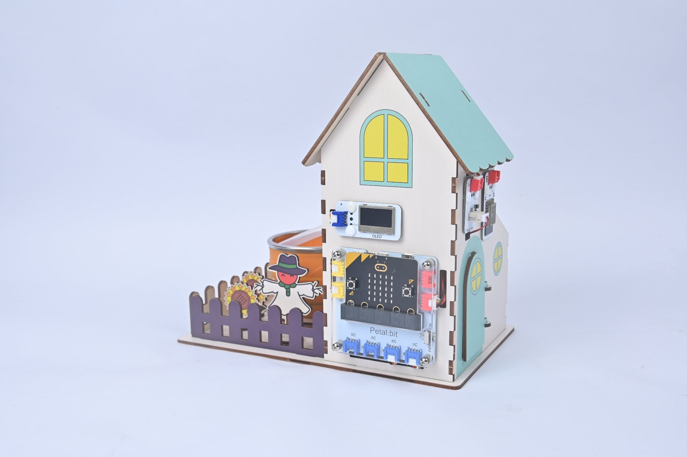
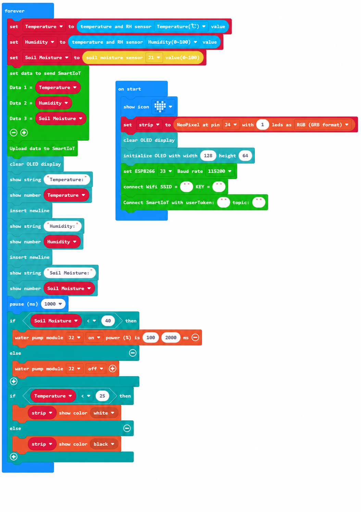

# Case 11: Complete Smart Farm · Cloud Integration

## Introduction

Combine lessons 9 and 10 with local automation, cloud data uploads and remote web control to build a complete IoT smart farm.

## Learning Objectives

1. Integrate local feedback control with cloud communication.

2. Understand how automatic and remote control modes coexist.

## Teaching Preparation

| Image | Item | Quantity | Notes |
| --- | --- | --- | --- |
| | Smart Farm Explorer Kit | 1 | Includes basswood structural parts |
|  | micro:bit | 1 | Prepare separately |
|  | PC | 1 | Prepare separately |

## Lesson Introduction

You have learned each function separately. Now make them work together: the farm normally cares for itself, while you can intervene through the platform whenever needed.

## Project Implementation

### Hardware Connection

Connect the modules listed in Teaching Preparation to the designated Petal:bit ports (J1, J2, J3, J4 or IIC).

### Programming Platform

Use the graphical programming platform [MakeCode](https://makecode.microbit.org/).

### Create a New Project

1. Open [MakeCode](https://makecode.microbit.org/).

   

2. Click **New Project**.

   

3. Enter a project name, such as `smart_farm_11`, and click **Create**.

   

### Add the Extension

1. Click **Extensions** in the MakeCode toolbox.

   

2. Search for `petal`.

   

3. Select the petal extension with the ELECFREAKS logo.

### Write the Program

Use the preview below to view and run the complete program, or open the shared project in MakeCode to edit it.

    <iframe
        title={"Case 11: Complete Smart Farm · Cloud Integration MakeCode sample program"}
        src="https://makecode.microbit.org/_AekceqTebTR5?lang=en&embed=1"
        frameBorder="0"
        sandbox="allow-popups allow-forms allow-scripts allow-same-origin"
        style={{ position: 'absolute', width: '100%', height: '100%' }}
    />

**MakeCode project:** [https://makecode.microbit.org/_AekceqTebTR5](https://makecode.microbit.org/_AekceqTebTR5)

> You can also download the program to your micro:bit from the webpage.

### Download the Program to micro:bit

1. Connect the PC to your micro:bit V2 with a USB cable.

   

2. A drive named `MICROBIT` appears on the computer when the connection succeeds.

   

3. Click `...` at the bottom left of MakeCode, then select **Connect Device**.

   

   

4. Click **Next** in the dialog.

   

5. Hold the button on the back of the micro:bit until the display shows **PAIRING MODE**, then release it. Return to the webpage and click **Pair**. Select `BBC micro:bit CMSIS-DAP` from the list and click **Connect**.

   

   

   

   

6. Click **Download** to transfer the program to micro:bit.

   

## Result

Combine local automatic control, cloud uploads and remote web control: soil-controlled irrigation, light-controlled supplementary lighting, temperature and humidity display and alarms, with cloud monitoring and control.

## Extended Knowledge

When sensing, control, networking and decisions work together, individual devices become a connected system. The complete smart farm is a small example of this integration.

### 1. The Value of Integration

Separate technologies have limited value in isolation. Linking their data and decisions can make the whole more effective than its parts. A single dashboard for irrigation, lighting, ventilation and alarms reduces the burden on operators.

Local automatic control provides a dependable foundation, while cloud coordination can improve broader decisions.

### 2. The Smart Agriculture Supply Chain

Upstream suppliers make sensors, chips, communication modules and intelligent equipment. Platform and algorithm companies provide data and decision services. Growers, cooperatives, retailers and consumers participate downstream in a more transparent supply chain.

Subsidies, insurance and carbon markets can provide policy and financial support.

### 3. Supporting Sustainable Agriculture

Precise use of water and fertilizer reduces waste and pollution. Photovoltaic agriculture and recirculating hydroponics can reduce environmental impacts, while market premiums for greener produce can support farmers. Local, intelligent production can strengthen resilience to disruptions.

### 4. Policy and Standards

Many countries connect smart agriculture with food security and rural development. Shared data interfaces, communication protocols and security standards are necessary to reduce data silos. Demonstration sites in agricultural parks and schools can help develop approaches that others can adopt.

### 5. Lessons from Global Examples

The Netherlands combines glass greenhouses with data-driven cultivation for high productivity per unit area. Israel combines drip irrigation and IoT in arid agriculture and exports related technology. China applies BeiDou positioning, 5G and drones at scale.

A smart farm is an interacting system rather than a pile of equipment. Your integrated miniature farm models the move toward understanding, using and adapting to environmental conditions.
