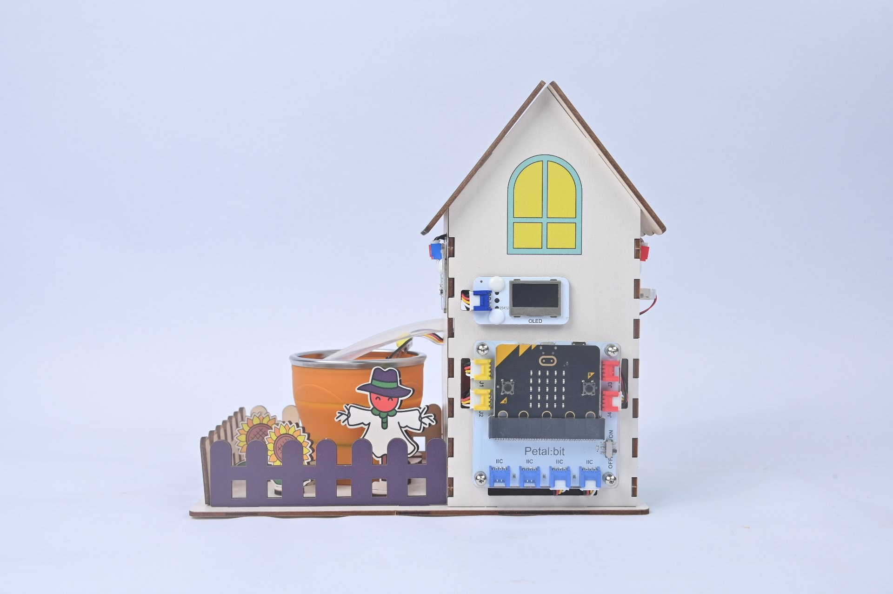
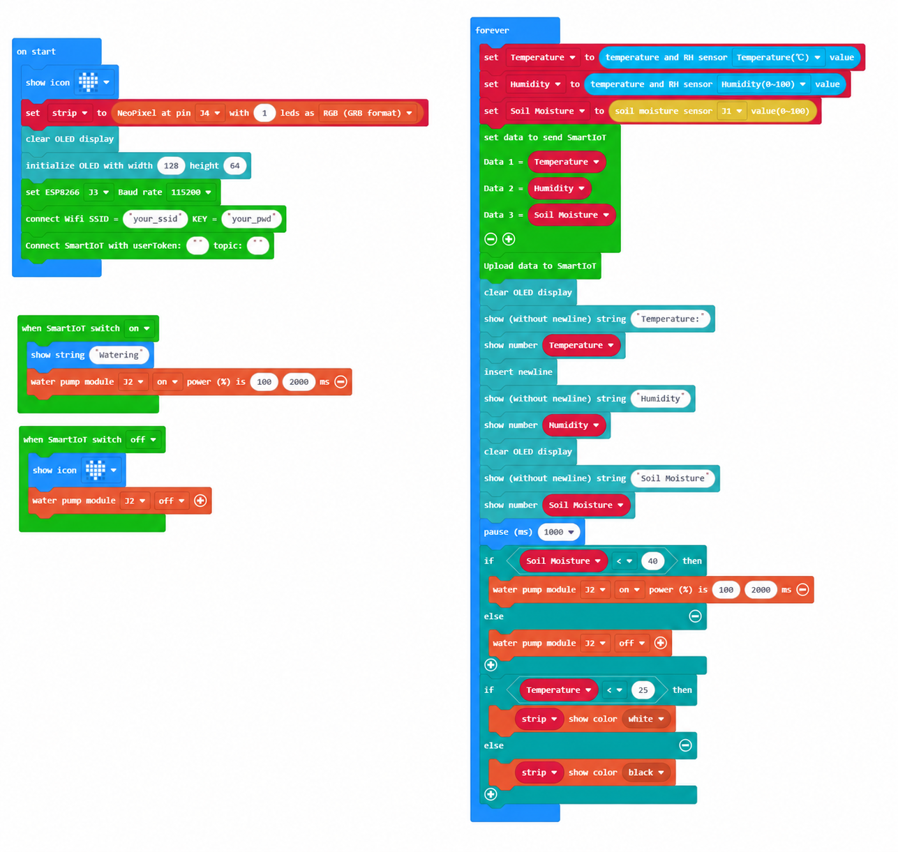

# Case 12: My Smart Farm · Creative Final Showcase

## Introduction

Apply the first eleven lessons in a group project. Integrate and debug the system, troubleshoot faults, add creative features, and present your project.

## Learning Objectives

1. Integrate all functions and debug the complete system.

2. Practice teamwork, troubleshooting and presentation skills.

## Teaching Preparation

| Image | Item | Quantity | Notes |
| --- | --- | --- | --- |
| | Smart Farm Explorer Kit | 1 | Includes basswood structural parts |
|  | micro:bit | 1 | Prepare separately |
|  | PC | 1 | Prepare separately |

## Lesson Introduction

Across twelve lessons, you have moved from assembling parts to writing IoT programs and built a farm that can care for itself. The final step is to give it your own style.

## Project Implementation

### Hardware Connection

Connect the modules listed in Teaching Preparation to the designated Petal:bit ports (J1, J2, J3, J4 or IIC).

### Programming Platform

Use the graphical programming platform [MakeCode](https://makecode.microbit.org/).

### Create a New Project

1. Open [MakeCode](https://makecode.microbit.org/).

   

2. Click **New Project**.

   

3. Enter a project name, such as `smart_farm_12`, and click **Create**.

   

### Add the Extension

1. Click **Extensions** in the MakeCode toolbox.

   

2. Search for `petal`.

   

3. Select the petal extension with the ELECFREAKS logo.

### Write the Program

Use the preview below to view and run the complete program, or open the shared project in MakeCode to edit it.

    <iframe
        title={"Case 12: My Smart Farm · Creative Final Showcase MakeCode sample program"}
        src="https://makecode.microbit.org/_cMk7TrFyeEdb?lang=en&embed=1"
        frameBorder="0"
        sandbox="allow-popups allow-forms allow-scripts allow-same-origin"
        style={{ position: 'absolute', width: '100%', height: '100%' }}
    />

**MakeCode project:** [https://makecode.microbit.org/_cMk7TrFyeEdb](https://makecode.microbit.org/_cMk7TrFyeEdb)

> You can also download the program to your micro:bit from the webpage.

### Download the Program to micro:bit

1. Connect the PC to your micro:bit V2 with a USB cable.

   

2. A drive named `MICROBIT` appears on the computer when the connection succeeds.

   

3. Click `...` at the bottom left of MakeCode, then select **Connect Device**.

   

   

4. Click **Next** in the dialog.

   

5. Hold the button on the back of the micro:bit until the display shows **PAIRING MODE**, then release it. Return to the webpage and click **Pair**. Select `BBC micro:bit CMSIS-DAP` from the list and click **Connect**.

   

   

   

   

6. Click **Download** to transfer the program to micro:bit.

   

## Result

Use what you learned in the first eleven lessons to combine sensors and actuators, debug the system, and demonstrate a complete creative farm project.

## Extended Knowledge

Across twelve lessons, you have turned a micro:bit into a responsive farm. Completing the course is a starting point for exploring the future of agriculture and education.

### 1. Real Agricultural Challenges

Projections have placed the global population near 9.7 billion in 2050, while cultivable land faces pressure and yield gains become harder. Water, fertilizer and labor constraints combine with climate variability. Food systems must provide nutrition, quality and diversity as well as enough calories.

### 2. Directions for Innovation

Genomic breeding can develop stress-tolerant, productive and nutritious crop varieties. Alternative and synthetic proteins may reduce pressure on land and emissions from livestock. AI and robots can support tasks from field inspection to harvesting and help address labor shortages. Vertical and marine agriculture explore additional growing spaces.

### 3. STEM Education and Agricultural Skills

Working on a real problem connects science, technology, engineering and mathematics through practice. Agriculture naturally combines biology, data, mechanics and business, encouraging systems thinking. Growing a living plant or making a program work can also inspire a future career.

### 4. Ways Young People Can Participate

Build a small school greenhouse, observe it over time and record data as citizen science. Use sensors to solve nearby problems, such as caring for classroom plants or studying cafeteria food waste. Share learning through videos and exhibitions to draw attention to food and land.

### 5. Imagining 2050

Small kitchen farms might produce fresh vegetables on demand. Fields could operate as distributed data systems in which individual crops are monitored and understood. Technology can become a bridge reconnecting people with land rather than separating them from nature.

Each line of code and each carefully delivered drop of water contributes to that future. Agriculture needs creators who understand both software and soil, and who help make useful innovations available more widely.
